# Cloud Doctor: Self-Healing Infrastructure

**Challenge 08 — Cloud · DevOps · Observability · SRE · Generative AI**

## Status (read this first)

| Aspect | Status |
|---|---|
| Research | **In progress** — see `docs/`; several areas still have gaps (`docs/14-research-summary/limitations.md`) |
| Architecture | **Proposed** (ADR-001…005 not yet Accepted) |
| Prototype | **None** — no code exists |
| Experimental results | **None** — ten experiments are designed, none executed |
| Production readiness | **Not claimed. Not applicable.** Sandbox only |

## What is Cloud Doctor?

A planned system that monitors a *simulated* cloud application, detects failures, correlates logs, metrics and events into an incident timeline, ranks likely root causes with cited evidence, recommends bounded recovery actions, executes approved actions **only in a sandbox**, and verifies whether recovery actually happened.

## Why does it exist?

Challenge 08 asks for failure detection, root-cause identification from logs and metrics, and a recommended recovery action, executed only in an isolated environment, with a dashboard, timeline, evidence-backed explanation, and verification report.

## Core principle

> Deterministic code observes, detects, enforces policy, executes and verifies. AI only helps correlate, explain and recommend, and the system must remain useful when the AI is unavailable.

## How it is planned to work

```mermaid
flowchart LR
    SIM[Simulated app] --> TEL[Prometheus / Loki / events]
    TEL --> DET[Detector]
    DET --> INC[Incident + timeline]
    INC --> EV[Evidence store EV-###]
    EV --> RCA[Deterministic RCA]
    RCA --> AI[AI explanation - optional]
    RCA --> POL[Policy engine]
    AI --> POL
    POL --> EXE[Sandbox executor]
    EXE --> VER[Recovery verification]
    VER --> REP[Report + audit]
```

## Key technologies (proposed, not final)

Full stack: `docs/10-architecture/tech-stack.md`. Summary — Python backend (FastAPI + Pydantic, SQLAlchemy/Alembic, PostgreSQL 18, a separate Python actuator process for policy invariants and sandbox execution) and a Next.js/TypeScript static-export dashboard served by nginx with SSE live updates (ADR-007, accepted). PostgreSQL, Prometheus + Alertmanager, Loki, Grafana. Sandbox: Docker Compose stack inside a **MicroVM with a private Docker daemon** (Docker Sandboxes proposed; Freestyle VMs or a plain dedicated VM as alternatives) — provisional until spikes pass. Policy: **hybrid** — in-process invariant guard plus client-editable OPA/Rego policy that can only tighten. LLM channels in the prototype: C0 (none) and C1 (vendor API). OpenTelemetry/tracing deferred.

## AI role and safety model

AI may summarise evidence, rank hypotheses and propose catalogue actions. AI may not run commands, change policy, hold credentials or reach the executor. Boundaries are meant to be enforced by process/network separation and typed validation, not prompts. Logs are treated as untrusted input. See `docs/05-ai/llm-role.md`, `docs/09-security/`.

## LLM delivery: hybrid channels

The AI layer is optional and delivered through client-selected channels behind one gateway: **C0** no LLM (deterministic only), **C1** vendor API, **C2** cloud-provider hosted, **C3** self-hosted/local, **C4** third-party gateway (not yet researched). Safety validators and policy are identical for every channel; failover never sends data to a less restrictive channel. See `docs/05-ai/llm-channels.md`, `docs/10-architecture/cost-performance.md`, ADR-006. Costs shown there are illustrative; measurement is pending.

## Failure scenarios (designed)

Redis outage, worker crash, CPU saturation, memory exhaustion, DB connection exhaustion, network latency, bad deployment, dependency outage, false correlation, failed remediation. Details: `docs/11-experiments/`.

## Evaluation

Metrics are defined (MTTD, precision/recall, top-k RCA accuracy, unsupported-claim rate, MTTR, unauthorized actions, remediation loops). **All measurement is pending.** See `docs/12-evaluation/`.

## Documentation map

`docs/00-overview` plan and map · `01-sre-foundations` · `02-observability` · `03-failure-detection` · `04-root-cause-analysis` · `05-ai` · `06-self-healing` · `07-chaos-engineering` · `08-recovery` · `09-security` · `10-architecture` · `11-experiments` · `12-evaluation` · `13-decisions` (ADRs) · `14-research-summary` · `_sources/register.md`.

## Roadmap

Phases 0–15 in `docs/14-research-summary/implementation-recommendations.md`. Implementation starts only after the architecture decisions are accepted.

## Limitations

Sandbox-only; small synthetic topology; results (when they exist) will not generalise to production; page content was gathered via a tool that may paraphrase, so quotations need re-verification.
