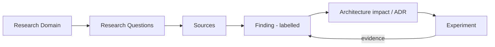
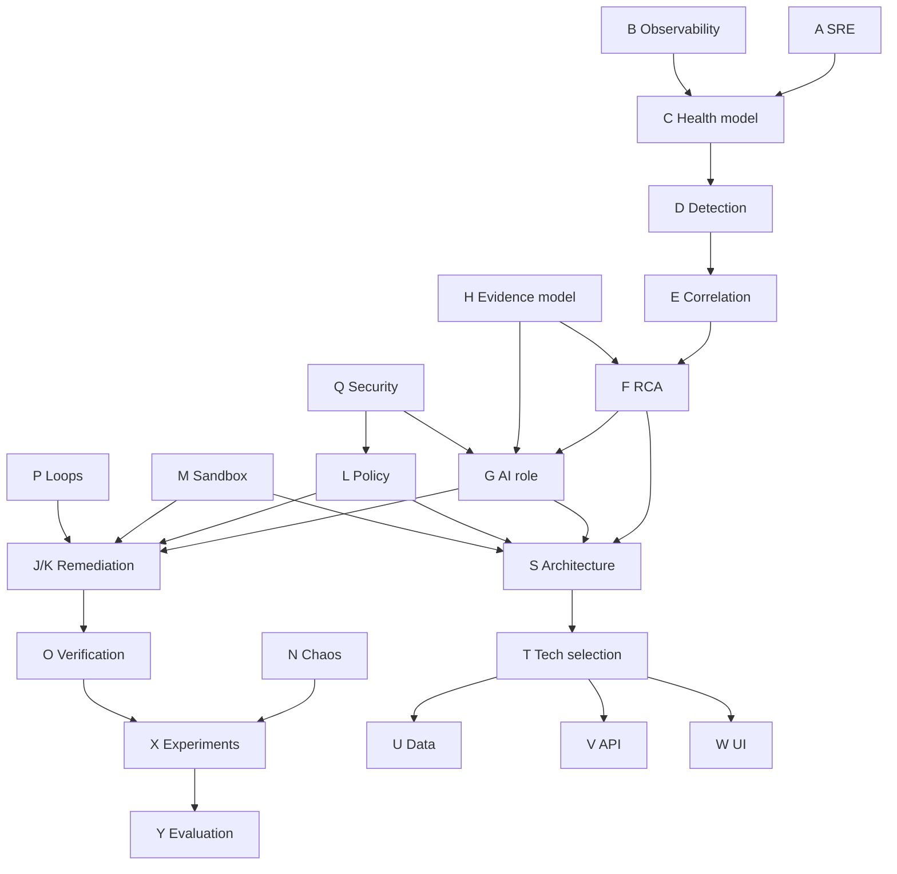

# Cloud Doctor: Research Map

**Status:** Draft v0.1 · Companion to [`00-research-plan.md`](00-research-plan.md)

Traces: **Research Domain → Questions → Sources → Expected Finding → Architecture Impact → Experiment**

> **Important:** the "Expected Finding" column is a **HYPOTHESIS** written *before* research, so it can be falsified. It is not a result. "Sources" lists *source types to locate and verify*; nothing here is cited yet. Experiment IDs (EXP-01…EXP-10) refer to the ten planned scenarios:
> EXP-01 Redis outage · EXP-02 Worker crash · EXP-03 CPU saturation · EXP-04 Memory exhaustion · EXP-05 DB connection exhaustion · EXP-06 Network latency · EXP-07 Bad deployment · EXP-08 Dependency outage · EXP-09 False correlation · EXP-10 Failed remediation.

---

## 1. Overview

Dependency between domain groups:

---

## 2. Map by domain

### Foundations

| Domain | Questions | Sources to locate | Expected finding (HYPOTHESIS) | Architecture impact | Experiment |
|---|---|---|---|---|---|
| **A SRE fundamentals** | RQ-01 | Google SRE Book/Workbook (SLOs, monitoring, incident response, postmortems); AWS Well-Architected Reliability pillar | SLI/SLO and error-budget concepts apply as *measurement framework* for the simulation; MTTD/MTTR measurable only with timestamped ground-truth injection | Defines SLIs (availability, latency, error rate) used by detector, verifier and evaluation | All (timestamps) |
| **B Observability** | RQ-02, RQ-03 | Prometheus, Grafana, Loki, OpenTelemetry, Alertmanager docs; telemetry-pipeline guidance | Metrics + logs + events suffice; tracing is optional; Prometheus + Loki + Grafana justified, OTel Collector adds value only if multi-signal pipeline needs it | ADR-002 (observability stack); telemetry flow | EXP-01…08 (telemetry sufficiency) |
| **C Service health model** | RQ-04 | Kubernetes probe docs; Google SRE (four golden signals); USE/RED method sources | Health = composite of golden signals + dependency state + saturation, with explicit unknown state when telemetry missing | Normalised `ServiceHealth` model; dashboard; verification | EXP-03, 04, 06 |

### Detection and diagnosis

| Domain | Questions | Sources to locate | Expected finding (HYPOTHESIS) | Architecture impact | Experiment |
|---|---|---|---|---|---|
| **D Failure detection** | RQ-05, RQ-06 | Prometheus alerting rules; Alertmanager grouping/inhibition docs; SRE Workbook on alerting on SLOs; surveys on anomaly detection | Rules with hysteresis cover hard failures; baseline/statistical detection helps gradual faults (memory leak, latency); ML is not justified at this scale | Deterministic detector with composite alerts; statistical module optional | EXP-02, 03, 04, 06; EXP-09 for FP |
| **E Incident correlation** | RQ-06, RQ-07 | Alertmanager inhibition; event-correlation literature; microservice dependency-graph papers | Static topology + time window grouping collapses cascading alerts into one incident, symptom vs. cause separated by dependency depth | Correlation engine, incident grouping rules | EXP-01, 05, 08 |
| **F Root-cause analysis** | RQ-07, RQ-08 | arXiv/ACM/USENIX RCA and AIOps papers; causal-inference and Bayesian-network references; vendor RCA docs | Graph/dependency + rule-based scoring is the strongest explainable baseline for small topologies; causal/Bayesian methods are costly for the benefit | Candidate-cause ranker with confidence, contradicting evidence, unknowns | All; EXP-09 critical |
| **H Evidence model** | RQ-10 | Provenance/audit-logging references; structured-output docs | Mechanical `EV-###` references allow automated grounding checks | Evidence store schema; AI output validator | EXP-01…10 (grounding rate) |
| **I Incident timeline** | RQ-11 | OpenTelemetry timestamp/semantic conventions; distributed-systems clock-skew literature | Single host removes most clock skew, but event vs. collection time must still be stored | Timeline data model; normaliser | EXP-07 (deploy events), EXP-09 |

### AI

| Domain | Questions | Sources to locate | Expected finding (HYPOTHESIS) | Architecture impact | Experiment |
|---|---|---|---|---|---|
| **G AI/LLM role** | RQ-09, RQ-10, RQ-18 | Anthropic/OpenAI docs (tool use, structured output); LLM-for-RCA papers; prompt-injection guidance (e.g., OWASP LLM Top 10) | LLM adds value for natural-language explanation and cross-signal hypothesis generation; it adds risk when it selects actions or reads raw logs unfiltered. H-AI-1: hybrid RCA ≥ deterministic-only on ambiguous cases | ADR-003 AI boundary; retrieval-through-tools; schema-validated output; deterministic fallback | EXP-09, EXP-10, injected-log test, LLM-down test |

### Action

| Domain | Questions | Sources to locate | Expected finding (HYPOTHESIS) | Architecture impact | Experiment |
|---|---|---|---|---|---|
| **J Self-healing** | RQ-12 | Self-healing/AIOps literature; Kubernetes controller pattern; vendor runbook-automation docs | Only low-risk, reversible actions are suitable for autonomous execution even in sandbox | Risk classes (low/medium/high) | EXP-01, 02 |
| **K Remediation strategies** | RQ-12 | Kubernetes rollout/restart docs; circuit-breaker and retry references | Restart, rollback, scale, cache-clear are enough for the ten faults; each needs preconditions, verification and rollback | Remediation catalogue | EXP-01…08, 10 |
| **L Safety / policy** | RQ-13 | OPA docs; Kubernetes RBAC; IAM least-privilege guidance | Allowlist + schema validation + rate/cooldown limits can be enforced in-process; OPA is justifiable mainly for demonstrating policy-as-code | ADR-005; policy layer; fail-closed rule | EXP-10, policy-bypass tests |
| **M Sandbox execution** | RQ-14 | Docker (isolation, networking, socket-mount risks); Kind/Minikube docs; Kubernetes namespaces/NetworkPolicy | Docker Compose with a restricted executor is simplest; Kind adds realistic probes/rollouts but more complexity. Mounting the Docker socket is itself a risk | ADR-004; executor design | Sandbox-escape/negative tests |
| **P Remediation loops** | RQ-17 | Circuit-breaker, backoff, retry-budget references; state-machine design | Max attempts + cooldown + escalation-to-human state prevents loops | Remediation state machine | EXP-10 |

### Validation

| Domain | Questions | Sources to locate | Expected finding (HYPOTHESIS) | Architecture impact | Experiment |
|---|---|---|---|---|---|
| **N Chaos engineering** | RQ-15 | Principles of Chaos Engineering; Chaos Mesh, LitmusChaos, Toxiproxy, stress-ng docs | Compose-native injection (stop/kill, Toxiproxy, stress-ng) is enough; Chaos Mesh/Litmus need Kubernetes and may be out of scope | Failure-injection component (separate trust zone) | EXP-01…09 |
| **O Recovery verification** | RQ-16 | Kubernetes readiness/liveness docs; SRE guidance on synthetic probing and canary analysis | Recovery = probes + synthetic transactions + error/latency within baseline + dependency health + stability window + no regression | Verification engine; before/after comparison | EXP-01…10 |
| **X Experiments** | RQ-20 | Chaos/experiment-design and reproducibility references | Pre-registered scenarios with ground truth avoid post-hoc rationalisation | Experiment framework | All |
| **Y Evaluation** | RQ-20 | Detection/RCA evaluation papers; calibration literature | Small synthetic sets give wide uncertainty; report ranges and baselines | Evaluation harness, results store | All |

### Cross-cutting

| Domain | Questions | Sources to locate | Expected finding (HYPOTHESIS) | Architecture impact | Experiment |
|---|---|---|---|---|---|
| **Q Security** | RQ-18 | OWASP LLM Top 10; container security docs; secrets-management guidance | Logs must be treated as untrusted data; never concatenated into instructions; credentials never reach LLM or telemetry | Threat model; trust boundaries; sanitisation layer | Malicious-log test |
| **R Failure modes** | RQ-19 | FMEA methodology references | Highest-risk modes: wrong RCA→wrong action, remediation loop, policy bypass | FMEA table; fail-closed degraded modes | EXP-09, 10, dependency-down tests |
| **S Architecture** | RQ-08, RQ-09 | Outputs of all above | Hybrid (D) likely, but must beat A/B on ADR criteria to be chosen | ADR-001 | — |
| **T Technology** | all | Official tool docs; LLM provider docs | Python/FastAPI, PostgreSQL, Prometheus, Loki, Grafana plausible; TimescaleDB, tracing, OPA to be justified individually | Technology decision table | — |
| **U Data** | RQ-10, RQ-11 | Evidence/timeline models from H, I | Entities: service, dependency, alert, incident, evidence, hypothesis, plan, action, verification, audit | ER diagram | — |
| **V API** | RQ-13 | API design/idempotency guidance | Execution endpoints need idempotency keys and authz; diagnosis is read-only | API spec | — |
| **W Dashboard** | RQ-04 | SRE incident-response guidance | Incident-centric view (health, timeline, evidence, approval, verification) beats metric-heavy dashboards | UI scope | Usability walkthrough |
| **Z Cost / performance** | RQ-21 | Prometheus cardinality guidance; LLM pricing pages (current at time of reading) | Cardinality and log volume stay trivial at this scale; LLM tokens dominate marginal cost, controllable via evidence summarisation | Retention, sampling, token budgets | Token/latency measurement |

---

## 3. Degraded-mode map (prompt §26)

Fail-safe principle (`DESIGN DECISION`): **safety-critical dependency failure ⇒ remediation fails closed.**

| Dependency down | Expected behaviour (HYPOTHESIS) | Experiment |
|---|---|---|
| LLM | Deterministic RCA + templated report; no AI explanation | LLM-down run |
| Prometheus / Loki | Health state `UNKNOWN`; no remediation based on missing data; self-alert | Telemetry-gap run |
| Policy engine | All execution denied | Policy-down run |
| Sandbox | Plan produced, not executed | Sandbox-down run |
| Database | Read-only/in-memory incident view, no execution | DB-down run |

---

## 4. Required-diagram tracker (prompt §13)

| # | Diagram | Planned location | Status |
|---|---|---|---|
| 1 | System context | `10-architecture/system-architecture.md` | pending |
| 2 | High-level architecture | same | pending |
| 3 | Telemetry flow | `02-observability/observability-fundamentals.md` | pending |
| 4 | Incident lifecycle | `01-sre-foundations/incident-management.md` | pending |
| 5 | RCA pipeline | `04-root-cause-analysis/hybrid-rca.md` | pending |
| 6 | Remediation safety flow | `06-self-healing/policy-engine.md` | pending |
| 7 | Recovery state machine | `06-self-healing/remediation-loops.md` | pending |
| 8 | Service dependency graph | `04-root-cause-analysis/dependency-analysis.md` | pending |
| 9 | Sequence diagram | `10-architecture/system-architecture.md` | pending |
| 10 | ER diagram | `10-architecture/data-architecture.md` | pending |
| 11 | Deployment architecture | `10-architecture/deployment-architecture.md` | pending |
| 12 | Security / trust boundaries | `09-security/threat-model.md` | pending |
| 13 | Failure-injection architecture | `07-chaos-engineering/failure-injection.md` | pending |
| 14 | Recovery verification architecture | `08-recovery/before-after-analysis.md` | pending |

---

## 5. Traceability to the prompt's §25 final-architecture questions

| §25 question | Primary domains | Primary RQ |
|---|---|---|
| What detects the problem? | D | RQ-05, 06 |
| What gathers evidence / builds the timeline? | B, H, I | RQ-02, 10, 11 |
| What determines root cause? | E, F | RQ-07, 08 |
| What role does AI play? | G | RQ-09 |
| What determines safety / executes / where? | J, K, L, M | RQ-12, 13, 14 |
| What determines recovery success? | O | RQ-16 |
| Failed remediation / loops? | P | RQ-17 |
| What is audited? | L, U | RQ-13 |
| AI or telemetry unavailable; wrong RCA; recovery worsens things? | R, §26 | RQ-19 |

---

## 6. Next steps

1. Create `docs/_sources/register.md`.
2. Begin Steps 3–4 of the execution order: SRE foundations and observability. These are the first documents that will contain sourced `RESEARCH FINDING`s.
3. Re-check this map after each step. Hypotheses that research contradicts are updated here, not silently deleted.
