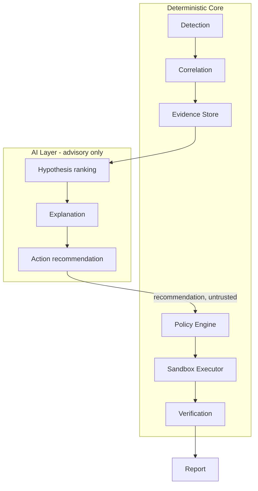
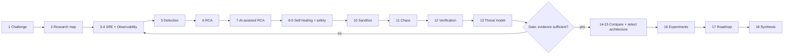

# Cloud Doctor: Research Plan

**Status:** Draft v0.1 · **Phase:** 0 — Research · **Type of document:** DESIGN DECISION + METHODOLOGY (no findings yet)

> Labels used throughout this repository: `RESEARCH FINDING`, `DESIGN DECISION`, `ASSUMPTION`, `HYPOTHESIS`, `IMPLEMENTATION PLAN`, `EXPERIMENTAL RESULT`, `OPEN QUESTION`.
> This document contains **no research findings and no experimental results**. It defines how they will be produced.

---

## 1. Project Definition

**Cloud Doctor** is a controlled, observable, evidence-driven, policy-constrained self-healing system for a *simulated* cloud application (Challenge 08).

It must: monitor → detect → correlate → diagnose → recommend → policy-check → recover (sandbox only) → verify → report.

**Core engineering principle (DESIGN DECISION, fixed):**

> Deterministic systems own observation, detection, policy enforcement, execution and verification. AI is limited to correlation assistance, diagnosis, explanation and remediation *recommendation*. The system must remain useful when the LLM is unavailable.



**Challenge deliverables (authoritative):**

1. Service-health dashboard with logs and metrics.
2. Failure detection and incident timeline.
3. Root-cause explanation supported by evidence.
4. Simulated recovery workflow and verification report.

**Out of scope (DESIGN DECISION):** any action against real/production infrastructure; autonomous remediation outside the sandbox; claims of production readiness.

---

## 2. Research Objective

Answer, with sourced evidence and later with experiments:

> How can an automated system reliably detect failures, correlate heterogeneous telemetry, infer likely root causes, recommend bounded remediation, safely execute it in an isolated environment, and verify actual recovery?

Sub-objectives:

- **O1** Determine where deterministic rules, statistics, topology/causal reasoning, and LLMs each belong.
- **O2** Select an architecture from at least four candidates (A–D) with documented trade-offs.
- **O3** Produce a threat model treating logs/telemetry as untrusted input.
- **O4** Define experiments and quantitative metrics *before* implementation.
- **O5** Produce an implementation roadmap that follows from the decisions, not from convenience.

---

## 3. Research Questions

IDs are stable; the research map (`00-research-map.md`) traces each to sources, expected findings, architecture impact and experiments.

| ID | Question | Domain |
|---|---|---|
| RQ-01 | Which SRE concepts (SLI/SLO, error budget, MTTD/MTTR) can be *measured* in a simulated environment, and how? | A |
| RQ-02 | What is the minimum telemetry set (metrics/logs/events/traces) needed for RCA of the ten target fault classes? | B |
| RQ-03 | Is distributed tracing necessary, or do metrics + logs + events + a static dependency graph suffice? | B |
| RQ-04 | Which signals should define service health state, and how should they be normalised and combined? | C |
| RQ-05 | Which detection method (threshold, rate, baseline, statistical, ML) fits each fault class? Is anomaly detection justified at all at this scale? | D |
| RQ-06 | How should alerts be deduplicated, grouped, suppressed, and protected from flapping (hysteresis)? | D, E |
| RQ-07 | How do we separate symptom from cause in a dependency chain? | E, F |
| RQ-08 | Which RCA family (rule, dependency/graph, statistical, causal, Bayesian, LLM, hybrid) gives the best accuracy/explainability/cost for a small topology? | F |
| RQ-09 | Where does an LLM add value over deterministic ranking, and where does it only add risk? | G |
| RQ-10 | What evidence model makes every AI claim traceable and mechanically checkable? | H |
| RQ-11 | How are timelines built reliably despite clock skew, duplicates and missing events? | I |
| RQ-12 | How should remediation actions be classified by risk and bounded by blast radius? | J, K |
| RQ-13 | What policy mechanism (OPA vs. in-process allowlist) enforces AI boundaries *technically*? | L |
| RQ-14 | Which sandbox (Compose, Kind, Minikube, VM) best makes production action impossible, not just discouraged? | M |
| RQ-15 | Which fault-injection approaches are necessary vs. over-engineered for this scope? | N |
| RQ-16 | What defines "recovered" beyond "container running"? What stability window is defensible? | O |
| RQ-17 | What state machine and budgets prevent remediation loops? | P |
| RQ-18 | How can untrusted log content (prompt injection, poisoning) be prevented from influencing actions? | Q |
| RQ-19 | How does Cloud Doctor behave when its own dependencies fail (fail-closed rules)? | R, §26 of prompt |
| RQ-20 | Which metrics quantify detection, diagnosis, recovery, safety and AI grounding, and how are they measured honestly? | Y |
| RQ-21 | What are the telemetry volume, cardinality and LLM-token cost drivers? | Z |

---

## 4. Research Domains

The 26 domains (A–Z) from the master prompt are retained. Grouping for execution:

| Group | Domains | Purpose |
|---|---|---|
| Foundations | A, B, C | Vocabulary, telemetry, health model |
| Detection & diagnosis | D, E, F, H, I | Turn signals into evidence-backed hypotheses |
| AI | G | Define the advisory boundary |
| Action | J, K, L, M, P | Bounded, policy-checked, sandboxed remediation |
| Validation | N, O, X, Y | Fault injection, recovery proof, experiments, metrics |
| Cross-cutting | Q, R, S, T, U, V, W, Z | Security, failure modes, architecture, tech, data, API, UI, cost |

**Relevance rule (from prompt §38):** if a topic does not materially affect Cloud Doctor, the corresponding document says so and explains why instead of padding. Likely candidates: TimescaleDB, full distributed tracing, profiling, SLA legal aspects, Chaos Mesh/Litmus (need Kubernetes). These are `HYPOTHESIS` until researched.

---

## 5. Source Strategy

Follows the tier hierarchy in the master prompt.

| Tier | Use | Examples (to be located and verified, not yet cited) |
|---|---|---|
| 1 Primary | Definitions, tool behaviour, limits | Google SRE Book/Workbook; Prometheus, Alertmanager, Grafana, Loki, OpenTelemetry docs; Kubernetes docs (probes, RBAC); Docker docs (isolation, networks); Open Policy Agent docs; AWS Well-Architected (Reliability); Anthropic/OpenAI docs on tool use & structured outputs |
| 2 Engineering/academic | RCA, anomaly detection, AIOps, chaos | ACM/IEEE/USENIX/arXiv papers on microservice RCA, AIOps and LLM-based incident analysis; Principles of Chaos Engineering; major-company engineering write-ups |
| 3 Secondary | Context only, flagged | Conference talks, reputable blogs |

Rules:

1. Every non-trivial claim gets a citation with a retrievable URL/DOI, captured in a **source register** (`docs/_sources/register.md`) with: ID, title, tier, URL, access date, claims supported.
2. No URL or paper is cited from memory. A source is added only after it has been opened and read. Claims that cannot be verified are tagged **Unverified / requires validation**.
3. Fact vs. interpretation are separated in prose (`RESEARCH FINDING` vs. `DESIGN DECISION`).
4. Academic RCA/AIOps claims are noted for evaluation context (datasets, injected-fault benchmarks) because published accuracy often does not transfer to other environments.

---

## 6. Research Methodology

For each important topic, follow the depth ladder:

```text
Definition → Industry practice → Academic research → Existing tools →
Alternatives → Advantages → Limitations → Cloud Doctor requirements → Recommendation
```

Process per document:

1. Frame the question(s) from §3.
2. Collect sources per §5; log them in the register.
3. Extract findings; label each `RESEARCH FINDING` with source IDs.
4. Compare alternatives in a table using *qualitative, evidence-backed* assessments (no invented numeric scores).
5. State the Cloud Doctor implication as a labelled `DESIGN DECISION` or `HYPOTHESIS`.
6. List limitations and open questions.

Execution order (prompt §36), with gates:



**Gate G1:** no architecture selection until RQ-01…RQ-18 each have either a sourced finding or an explicitly recorded gap.

---

## 7. Evidence Methodology

Two distinct evidence concepts:

**(a) Research evidence** — sources supporting design claims (§5, source register).

**(b) Runtime evidence** — observations Cloud Doctor itself collects during an incident. `DESIGN DECISION` (to be refined in Domain H):

| Field | Purpose |
|---|---|
| `evidence_id` (`EV-###`) | Stable reference; AI findings must cite these |
| `source` / `type` | prometheus, loki, docker-event, health-probe, deploy-event… |
| `service` | Subject of observation |
| `observed_at` / `collected_at` | Separates event time from collection time (clock skew) |
| `query` | Exact query that produced it (reproducibility/provenance) |
| `value` / `content` | Raw value; log content flagged **untrusted** |
| `integrity` | Hash of stored payload |

Epistemic ladder enforced in data model and reports:

```text
Observed fact  ≠  Correlation  ≠  Hypothesis  ≠  Confirmed root cause
```

A root cause is "confirmed" only by an explicit criterion (e.g., recovery verified after targeted remediation, or controlled-injection ground truth in experiments) — never by temporal ordering alone.

---

## 8. Architecture Decision Methodology

1. Derive requirements (`FR-xxx`, `NFR-xxx`) *before* options, from the challenge spec and research findings.
2. Evaluate at least four candidates:
   - **A** rule-based monitoring + deterministic remediation
   - **B** rule-based monitoring + AI-assisted RCA
   - **C** AI-agent investigation + policy-controlled remediation
   - **D** hybrid
3. Compare on fixed criteria: detection fidelity, RCA explainability, safety/blast radius, behaviour with LLM down, testability, implementation effort, token/infra cost, auditability, demonstration value for the challenge.
4. Record each major decision as an ADR (options, rationale, tradeoffs, reconsideration conditions). ADR-001…005 are reserved for architecture, observability, AI boundary, sandbox, policy engine.
5. Prior expectation, **to be tested rather than assumed**: a hybrid (D) will win. If research shows A or B is sufficient, the recommendation should say so.
6. Answer all 17 questions in prompt §25 in the final architecture.

---

## 9. Experiment Methodology

- Controlled fault injection against a simulated topology (initial sketch: gateway → API → Redis / worker → PostgreSQL). `ASSUMPTION` pending sandbox research.
- Each experiment follows the template in prompt §20 and is **designed before it is run**, including steady-state hypothesis, blast radius, ground-truth root cause, expected telemetry, success criteria.
- Ten planned scenarios: Redis outage, worker crash, CPU saturation, memory exhaustion, DB connection exhaustion, network latency, bad deployment, dependency outage, **false-correlation scenario**, **failed-remediation scenario**.
- Include negative/adversarial cases: unrelated concurrent events, malicious log lines (prompt injection), LLM unavailable, telemetry gap, remediation that worsens health.
- Repetition: each scenario run N times (N to be set by variance observed; ≥ several runs to report a range, not a single anecdote). Seeds, versions and configs recorded for reproducibility.
- Results sections stay **empty/"pending"** until runs happen.

---

## 10. Evaluation Methodology

Metric families (definitions to be formalised in `12-evaluation/`):

| Family | Metrics |
|---|---|
| Detection | MTTD, precision, recall, FP/FN rate |
| Diagnosis | top-1/top-k root-cause accuracy, evidence coverage, unsupported-claim rate, confidence calibration |
| Recovery | remediation success rate, MTTR, failed-remediation rate, rollback rate |
| Safety | unauthorized-action count, policy violations, remediation loops, max blast radius |
| AI | hallucination rate, evidence-grounding rate, tool-call accuracy, recommendation accuracy |

Principles:

- Ground truth comes from the injected fault, not from the system's own opinion.
- Compare against baselines: deterministic-only RCA vs. hybrid, to test whether AI actually helps (`HYPOTHESIS H-AI-1`).
- Report variance and sample sizes; state that small synthetic benchmarks do not support generalisation.
- Target metrics may be stated now; **measured values only after execution**. Until then: "Experimental measurement is pending."

---

## 11. Documentation Plan

Tree per master prompt §14 (`docs/00-overview` … `docs/14-research-summary`), plus `docs/_sources/register.md` and root `README.md`.

- Substantial docs use the standard section template (§15 of prompt); small docs may omit sections.
- Overlapping documents are consolidated, not padded (e.g., `thresholds.md` may merge into `detection-methods.md`; `ai-evaluation.md` appears in both `05-ai` and `12-evaluation` and will be a single source with a pointer).
- Mermaid: valid GitHub-flavoured syntax, multiple focused diagrams; the 14 required diagrams are tracked in a checklist in `00-research-map.md`.
- Creation order follows §6 gating, not directory numbering.

---

## 12. Expected Outputs

| Phase | Output |
|---|---|
| Now | `00-research-plan.md`, `00-research-map.md` |
| Research | Domain documents (01–09), source register |
| Design | Requirements, threat model, architecture options + ADRs (10, 13) |
| Validation design | Experiment and evaluation frameworks (11, 12) |
| Synthesis | `14-research-summary/*`, `final-architecture.md`, `README.md` |
| Implementation (later, gated) | Roadmap phases 0–15 with objectives, prerequisites, deliverables, tests, acceptance criteria, risks |

---

## 13. Open Questions

| ID | Question |
|---|---|
| OQ-01 | Is Docker Compose isolation sufficient to make production action *structurally impossible*, or is Kind/Kubernetes needed to demonstrate realistic recovery (probes, rollouts, RBAC)? |
| OQ-02 | Which LLM option fits: hosted API, local model, or both behind one interface? Data-handling and cost implications. |
| OQ-03 | Is OPA warranted versus a small typed in-process policy evaluator for this scale? |
| OQ-04 | What sample size/run count gives meaningful variance for RCA accuracy with ~10 scenarios? |
| OQ-05 | How to simulate realistic *cause-vs-symptom* ambiguity without the test designer unconsciously encoding the answer? |
| OQ-06 | What is a defensible stability window for recovery verification in a short-lived simulation? |
| OQ-07 | How should "confirmed root cause" be defined for the non-injected (real-world-like) case? |
| OQ-08 | Do human-approval gates need to be demonstrated in the dashboard even when the sandbox is safe? |

---

## 14. Initial Assumptions

All are `ASSUMPTION` until validated.

| ID | Assumption | Validation |
|---|---|---|
| AS-01 | The simulated app is small (≈4–6 services) with a known, static dependency graph. | Requirements doc |
| AS-02 | A single-host sandbox (Docker Compose or Kind) is available on the developer machine. | Sandbox research, OQ-01 |
| AS-03 | Metrics + logs + container/deploy events cover the ten fault classes; traces are optional. | RQ-03, experiments |
| AS-04 | Ground truth for every experiment is known because we inject the fault. | Experiment design |
| AS-05 | LLM output can be constrained to a schema and checked mechanically against evidence IDs. | Domain G research |
| AS-06 | Hybrid architecture (D) will be preferred. | Gate G1 / ADR-001 (to be falsifiable) |
| AS-07 | Team = single developer; effort and scope must be sized accordingly. | Roadmap |

---

## 15. Research Risks

| ID | Risk | Impact | Mitigation |
|---|---|---|---|
| RR-01 | Scope explosion (26 domains) → shallow docs | Poor credibility | Relevance rule; consolidate; depth where it changes architecture |
| RR-02 | Unverified or fabricated citations | Loss of rigour | Source register; cite only opened sources; mark unverified |
| RR-03 | Confirmation bias toward a hybrid-AI design | Weak decision | Explicit falsification criteria in ADRs; deterministic baseline in evaluation |
| RR-04 | Synthetic experiments overfit to my own RCA rules | Inflated accuracy | Include false-correlation and unseen scenarios; report limits |
| RR-05 | Published AIOps/RCA results don't transfer | Misleading expectations | Treat as context, not targets |
| RR-06 | LLM/tool versions change between runs | Irreproducible AI results | Pin model IDs, parameters, prompts; record in run metadata |
| RR-07 | Premature implementation | Architecture shaped by code convenience | Gate G1; no implementation before ADRs |
| RR-08 | Overclaiming in README/portfolio | Credibility damage | Explicit Research / Prototype / Result / Production-readiness labels |
| RR-09 | Sandbox gives false sense of safety | Unsafe design carried forward | Threat model includes sandbox escape; defence-in-depth (policy + isolation + least privilege) |
