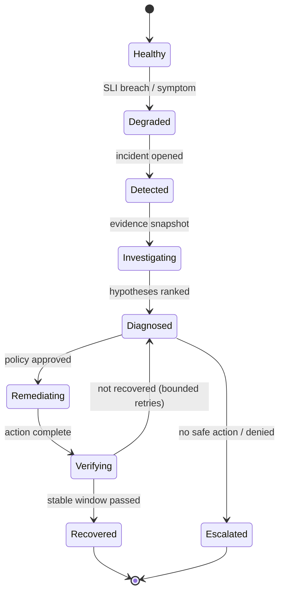

# Incident Management and Troubleshooting

## Abstract

Cloud Doctor automates parts of incident response. The Google SRE book describes how humans do it; those practices define what the system must preserve (declared incident, living record, evidence, one actor changing the system) and what it must not do (freelancing, premature root-causing).

## Research Findings (RESEARCH FINDING)

Sources: [S-013] Ch. 14 Managing Incidents, [S-014] Ch. 15 Postmortem Culture, [S-015] Ch. 12 Effective Troubleshooting. Single-read extractions; verify wording before quoting.

### Incident management [S-013]

- Based on the Incident Command System. Roles: Incident Command (holds state, assigns work), Operations (the only group that should modify the system during an incident), Communication, Planning.
- A **living incident document** is the commander's most important artifact; messy is fine, functional is required; retained for postmortem.
- Declare early. Guidelines: a second team is needed; customers can see it; unsolved after about an hour of concentrated analysis.
- Handoffs must be explicit and acknowledged.
- Anti-pattern: **freelancing** — uncoordinated changes.
- Priority: "Stop the bleeding, restore service, and preserve the evidence for root-causing."

### Mitigation before root cause [S-015]

- The instinct to root-cause first should be ignored; first make the system work as well as possible. Preserve logs for later analysis. Fixing the proximate cause need not wait for the postmortem.

### Troubleshooting method [S-015]

- Hypothetico-deductive: observe, hypothesize, test, repeat. Steps: Triage, Examine, Diagnose, Test and Treat, Cure. Ask "what, where, why". "What touched it last" (recent changes) is a standard starting point.
- Listed pitfalls: irrelevant symptoms or misread metrics; misunderstanding how to change the system; wildly improbable theories or latching on to past causes; **spurious correlations that are coincidences or share a cause**.
- Correlation is not causation; with many metrics coincidental correlations are inevitable. Production causes are often only "probable causal factors". Prefer simpler explanations.
- Case study: a correlated slow query type was spurious because other requests were also slow; the root cause was elsewhere.

### Postmortems [S-014]

- Written record of incident, impact, mitigation actions, root cause(s), follow-ups. Blameless: fix systems, not people. Triggers include on-call intervention such as rollback or traffic rerouting, and monitoring failures. Unreviewed postmortems "might as well never have existed".

### Not found

No formal MTTR/MTTD definition in these chapters (confirmed absent in the three read; other chapters unread).

## Cloud Doctor Application (DESIGN DECISIONS)

| Source practice | Cloud Doctor mapping |
|---|---|
| Declared incident, living document | Incident record + timeline created at detection; append-only |
| Ops alone changes the system | Single executor component; no other component may mutate the sandbox (prevents freelancing) |
| Stop bleeding, preserve evidence | Collect and snapshot evidence **before** remediation (restart destroys logs/state) |
| Hypothesis → test | Hypotheses are explicit objects; remediation doubles as a test; verification confirms or refutes |
| Spurious-correlation warning | EXP-09 false-correlation scenario; hypotheses carry contradicting evidence |
| Postmortem | Auto-generated recovery report with timeline, evidence IDs, actions, verification, open questions; flagged for human review |
| Mitigation ≠ root cause | Report distinguishes "mitigated" from "root cause confirmed" |

Incident lifecycle (aligned with the required states):

## Limitations / Open Questions

- Google's roles assume human teams; the mapping is analogy, not validation.
- Evidence snapshotting overhead vs. completeness; unmeasured.

## References

- [S-013] https://sre.google/sre-book/managing-incidents/
- [S-014] https://sre.google/sre-book/postmortem-culture/
- [S-015] https://sre.google/sre-book/effective-troubleshooting/
