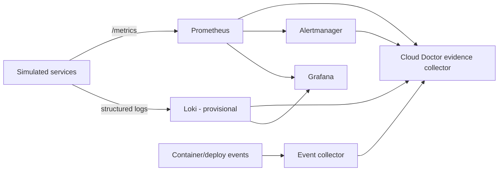

# Observability Fundamentals and Stack Selection

## Abstract

This document defines observability and its signals using primary sources, then evaluates which tools Cloud Doctor should use. Prometheus findings are sourced; **Loki and OpenTelemetry Collector choices are provisional** because those docs have not been read in full (see source register).

## Problem

Cloud Doctor needs enough telemetry to detect all ten planned fault classes and to build evidence, without adopting every popular tool.

## Concepts (RESEARCH FINDING)

- **Observability** [S-008]: lets you understand a system from the outside by asking questions without knowing its inner workings; the system must be instrumented.
- **Telemetry** [S-008]: data emitted from a system and its behavior — traces, metrics, logs.
- **Reliability** [S-008]: whether the service does what users expect; a system can be "up" 100% of the time and still be unreliable.
- **Monitoring** [S-002]: collecting, processing, aggregating and displaying real-time quantitative data about a system.
- **White-box vs. black-box monitoring** [S-002]: white-box uses internal metrics; black-box tests externally visible behavior. Google's stated position is heavy white-box use with modest but critical black-box use. Black-box detects active symptoms; white-box can also catch imminent problems and failures masked by retries.
- **Symptom vs. cause** [S-002]: monitoring must answer "what's broken" (symptom) and "why" (cause). One person's symptom can be another's cause.
- **Log–trace correlation** [S-008, S-009]: logs are most useful when correlated with a trace and span; OpenTelemetry log records carry TraceId/SpanId and structured logs are preferred for correlation.

## Prometheus (RESEARCH FINDING)

- Open-source monitoring and alerting toolkit; time series with key-value labels; **pull** collection over HTTP, push via gateway; stores samples locally; single nodes autonomous [S-007].
- Not suited to 100%-accurate data such as per-request billing [S-007]. Implication: Cloud Doctor treats Prometheus data as sampled evidence, not exact counts.
- Every unique label combination is a new time series; don't use high-cardinality labels (user IDs, emails) [S-006].
- Alerting rules: `for` holds an alert *pending* until the condition persists; `keep_firing_for` keeps it firing to prevent flapping and false resolution during data gaps [S-005].
- Alertmanager groups, inhibits, silences and routes alerts [S-004]. It deduplicates and groups, e.g., a partition into one notification.

## Metrics vs. logs vs. events vs. traces for Cloud Doctor

| Signal | Answers | Fault classes it serves (HYPOTHESIS) | Notes |
|---|---|---|---|
| Metrics | How much / how fast / is it trending | CPU, memory, latency, error rate, queue depth | Primary for detection |
| Logs | What did the component say | Connection refused, OOM, exceptions, bad deploy | **Untrusted text**; primary for cause evidence |
| Events | What changed | Container restarts, deploys, injected faults, remediation actions | Key for "what changed" and the timeline |
| Traces | Where in the request path | Latency attribution across services | Optional (RQ-03) |

## Candidate stack

| Requirement | Candidate | Decision (provisional) | Reason | Tradeoff |
|---|---|---|---|---|
| Metrics | Prometheus | **Adopt** | Standard; pull model fits small static topology; native alerting rules [S-004, S-005, S-007] | Local storage; not exact counts |
| Alert routing | Alertmanager | **Likely adopt** | Provides grouping/inhibition/silences without custom code [S-004] | Cloud Doctor still needs its own incident model; evaluate whether it must consume Alertmanager webhooks or evaluate rules itself |
| Logs | Loki | **Provisional** | Label-indexed logs, low overhead; label cardinality guidance exists [S-011, V-search only] | Must keep labels low-cardinality; unverified until docs are read |
| Dashboard | Grafana | **Likely adopt** | Common SRE view for metrics/logs | Does not satisfy the incident-centric UI requirement alone; custom incident view still needed |
| Traces / pipeline | OpenTelemetry | **Defer** | Signals/correlation model is useful [S-008, S-009]; tracing not shown to be required | Added complexity; decide after RQ-03 experiments |

Alternatives not yet researched: Elasticsearch/OpenSearch, VictoriaMetrics, Docker/journald direct collection.

## Recommended Approach (DESIGN DECISION, provisional)

1. Metrics + logs + events are mandatory; traces optional.
2. All services emit structured logs with a correlation/request ID so log–request linkage doesn't depend on tracing.
3. Keep metric and log label sets bounded; request-level identifiers belong in log bodies, not labels.
4. Treat telemetry gaps as a first-class state (`UNKNOWN`), not as healthy.

## Cloud Doctor Application

## Risks

- Telemetry pipeline failure blinds detection; Cloud Doctor must detect missing telemetry (Domain R).
- Logs may contain attacker- or fault-controlled text (Domain Q).
- Prometheus scrape interval bounds detection latency (**HYPOTHESIS**, to measure in experiments).

## Limitations

- Loki and OTel conclusions are provisional pending reads of their documentation.
- No Kubernetes assumed; if Kind is chosen, probe and event semantics (S-010) enter the design.

## Open Questions

- Should Cloud Doctor evaluate its own detection rules or rely on Prometheus/Alertmanager? (feeds ADR-002)
- Need for OpenTelemetry Collector versus direct scraping.

## References

- [S-002] https://sre.google/sre-book/monitoring-distributed-systems/
- [S-004] https://prometheus.io/docs/alerting/latest/alertmanager/
- [S-005] https://prometheus.io/docs/prometheus/latest/configuration/alerting_rules/
- [S-006] https://prometheus.io/docs/practices/naming/
- [S-007] https://prometheus.io/docs/introduction/overview/
- [S-008] https://opentelemetry.io/docs/concepts/observability-primer/
- [S-009] https://opentelemetry.io/docs/concepts/signals/logs/
- [S-011] https://grafana.com/docs/loki/latest/get-started/labels/bp-labels/ (search-snippet only)
