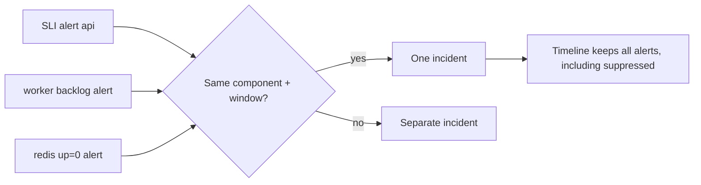

# Alert Correlation, Deduplication and Suppression

## Abstract

How raw alerts become a single incident. Authoritative sources cover Alertmanager's mechanics and Google's caution about dependency-based suppression; the broader correlation literature was only seen as vendor material (Tier 3), so techniques beyond Alertmanager are **hypotheses**.

## Research Findings (RESEARCH FINDING)

### Alertmanager mechanics [S-004, S-060, S-061]

- Grouping bundles alerts by `group_by` labels; timing via `group_wait` (default 30s), `group_interval` (5m), `repeat_interval` (4h).
- Inhibition mutes target alerts while a source alert exists, when the `equal` labels match; missing labels and empty labels are treated as the same. Docs warn against rules where an alert matches both sides.
- Silences mute by matchers for a time.
- Deduplication: alerts carry a `fingerprint`; HA clusters aim for at-least-once delivery and may send duplicates, so consumers should be idempotent [S-061].

### Google guidance [S-002]

Complex dependency hierarchies have had limited success; dependency rules suit stable parts of the system; filter cases where users aren't affected. Multiple burn-rate rules fired by one incident need suppression [S-003].

### Practitioner material (Tier 3, S-064 — search snippets only)

Vendors describe layered techniques: fingerprint dedup, topology/dependency mapping, trace-context correlation, time-window clustering, ML similarity grouping; time-window clustering can falsely group during alert storms; over-merging indicates too wide a window or too low a threshold; Alertmanager's grouping is label equality, not causal reasoning. Vendor noise-reduction figures vary widely and are not evidence for this project.

## Design (DESIGN DECISION, provisional)

1. **Alert → incident grouping key:** shared environment + connected component in the declared dependency graph + time window (initial value to tune from EXP-01/08). Not label equality alone.
2. **Dedup:** key on `fingerprint`/`groupKey`; webhook handler idempotent.
3. **Suppression:** only explicit, few rules from the declared graph (e.g., downstream-symptom alerts annotated, not hidden, while the upstream cause alert is firing). Suppressed alerts remain in the timeline as evidence — suppression affects notification, not recording.
4. **Flap control:** hysteresis via `for` / `keep_firing_for` [S-005], plus a stability window before closing.
5. **Incident merge/split:** a second independent fault during an open incident must open a separate incident if it is outside the connected component (guards against the mega-incident failure mode).
6. **Symptom vs. cause labelling:** each alert carries a layer tag (user-facing symptom, dependency state, resource saturation) to support RCA.

7. **Expected-state registry:** maintenance windows, intentional faults and drained targets are declared with owner, reason and expiry, appear in the timeline, and prevent false incidents without hiding data (informed by the project's own alerting-verification notes on silences and by [S-002] on filtering drained traffic and test deployments).
8. **Topology as code:** scrape targets, dependency graph, health probes and the expected-state registry are generated from one declarative service catalog, so monitored targets cannot diverge from the real topology (a documented false-positive source in the project's observability notes: scrape fragments that stay loaded after a component is disabled make the target appear down).
9. **Missing-signal states:** *no data (expected)*, *no data (unexpected)*, *collection failed* — each handled differently by detection and RCA.

## Metrics

Alerts per incident, incident count vs. injected faults (merge/split errors), duplicate notifications, time to grouping — all pending measurement (EXP-01, 08, 09).

## Limitations / Open Questions

- The initial time window is a guess.
- Scholarly sources on alert correlation were not located; the claims above rest on Alertmanager docs and Google's book.

## References

S-002–S-005, S-060, S-061, S-064.
