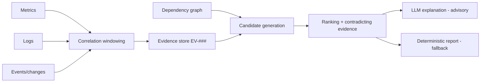

# Root-Cause Analysis Fundamentals

## Abstract

What the literature says about automated RCA in microservice systems, and what it implies for a small sandbox. Surveys give the taxonomy; one empirical study (ASE'24) tests causal-inference methods and finds poor transfer. The strongest evidence is limited: only abstracts and partial text were read, noted below.

## Problem

Given symptoms in several services, rank candidate causes and justify the ranking. Temporal order alone does not establish cause (S-015).

## Research Findings (RESEARCH FINDING)

### Taxonomy [S-020, partial read]

By data source: metric-based, trace-based, log-based, multi-modal, and LLM-enhanced. By method family: dependency/topology graph, operations knowledge graph, rule-based, statistical, time-series, graph-theory (random walk, traversal), and ML/DL. Reported challenges (via summary, Section 5): noisy or incomplete data, ambiguity in graph construction and edge direction, dynamic topology, multi-modal integration, correlation vs. causation, multi-component causal chains, LLM hallucination and cost.

### Empirical evidence on causal-inference RCA [S-021]

An evaluation of 9 causal-discovery methods and 21 RCA methods (verbatim abstract claims):

- "No method stands out in all situations"; methods fall short in effectiveness, efficiency, or are parameter-sensitive.
- Performance on synthetic datasets "may not accurately reflect" performance on real systems.
- "There is still a large room for further improvement."

From the first ~35% of the paper (verbatim): benchmarks were Sock Shop, Online Boutique and Train Ticket on a four-node Kubernetes cluster with five injected fault types (CPU hog, memory leak, disk IO stress, network delay, packet loss). Causal-discovery methods struggle with large graphs and edge direction; running time grows significantly with system size; longer input data improves performance.

Figures such as F1 0.1–0.54 for graph discovery and several methods performing like a random baseline were read only via summary — **Unverified / requires validation** against the paper's tables before quoting.

### Troubleshooting practice [S-015]

Hypothetico-deductive method; recent changes are a primary suspect; spurious correlations are inevitable among many metrics and may share a hidden common cause; causes in production are often "probable causal factors".

### Scope [S-022]

Soldani & Brogi survey anomaly detection and RCA in multi-service applications (abstract-level only read).

### Probabilistic / Bayesian approaches (search-level only — S-047, S-048)

Search results identify: BARO (FSE 2024), which pairs multivariate Bayesian online change-point detection with a robust scorer to rank root causes — a Bayesian *detection* step with a scoring *ranker*, not a Bayesian network; GRALAF (CNSM 2022), a causal Bayesian network learned (NOTEARS) from fault-injection data; and a 2026 ICML poster on Bayesian root cause discovery (abstract-level). **None of these was opened**; no performance claim is made. Note that S-021 evaluated BARO among its 21 methods; per its summary-level read BARO was among the fastest and did well on some benchmarks, which is **unverified** until the paper tables are read.

## Alternatives for Cloud Doctor

| Approach | Strength | Weakness | Fit (HYPOTHESIS) |
|---|---|---|---|
| Rule-based on known fault signatures | Explainable, testable, cheap | Misses novel faults; encodes the designer's assumptions | Baseline |
| Dependency-graph scoring (declared topology) | Separates symptom from upstream cause; no learning | Topology must be accurate; hidden dependencies | Core |
| Causal discovery on metrics (PC, Granger…) | Can find unknown links | Poor generalization, expensive, direction errors [S-021] | Probably not justified for ≤6 services with a known graph |
| Statistical anomaly ranking per service (e.g., deviation scores) | Simple, no topology needed | Ranks anomalies, not causes | Evidence input |
| LLM-assisted | Natural-language synthesis, cross-signal reasoning [S-023–S-026] | Reasoning failures, hallucination | Advisory only (see `llm-role.md`) |

## Recommended Approach (DESIGN DECISION, provisional)

Hybrid: deterministic candidate generation (topology + change events + fault signatures) → scoring that outputs likely cause, confidence, supporting and **contradicting** evidence, alternatives, unknowns → optional LLM explanation constrained to cited evidence. Causal-discovery learning is deferred; the declared dependency graph is a known quantity in the sandbox.

## Cloud Doctor Application

## Risks and Limitations

- A small, known-topology sandbox is easy: published difficulty (large graphs, noise) does not apply, so good local accuracy would not generalize. State this in results.
- Rules and scenarios are written by the same person; risk of circular evaluation (RR-04).
- Only abstracts of S-022–S-026 were read; no claim about their results beyond abstract statements.

## Open Questions

- Full-text read of S-020 sections 4–5 and S-021 results tables.
- Bayesian/probabilistic ranking: not yet researched.

## References

S-015, S-020, S-021, S-022 (see `docs/_sources/register.md`).
