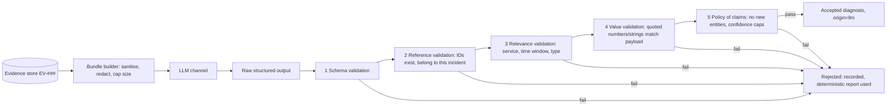

# Evidence Grounding and Hallucination Control

**Status:** design. Merges the planned `evidence-grounding.md` and `hallucination-control.md` because the controls are the same mechanism. Nothing implemented; no measurements.

## Problem

An LLM's explanation can be fluent and wrong. Cloud Doctor must make unsupported claims *detectable by code*, not by trusting the model or the prompt.

## What the sources support (RESEARCH FINDING)

- Schema-constrained output (`strict: true`, JSON outputs, Ollama `format`, vLLM `response_format`) guarantees **syntactic** conformance; the Anthropic page does not claim semantic correctness of argument values [S-054, S-090, S-091]. Refusal or truncation can produce non-conforming output [S-055, summary].
- LLM RCA studies show promise on historical incidents [S-023, S-025]; an agent with retrieval tools reported "highly increased factual accuracy" over baselines [S-024, abstract]; a 2026 study catalogued 16 kinds of reasoning failure in LLM RCA and used an LLM judge for annotation [S-026, abstract]. These are abstract-level readings.
- Untrusted content should be delivered as labelled, encoded tool results, and tool outputs can be screened [S-038].
- OWASP lists Misinformation and Improper Output Handling among LLM risks [S-036].

**Interpretation:** correctness of *content* cannot come from the model or schema; it must come from checks against the evidence store.

## Mechanism (DESIGN DECISION)



### Output contract (illustrative)

```json
{
  "hypotheses": [
    {
      "cause_id": "redis_unavailable",
      "claims": [
        {"text": "api logs show repeated connection refused to redis", "evidence": ["EV-004", "EV-007"], "type": "observation"},
        {"text": "redis target was down before the api error rate rose", "evidence": ["EV-001", "EV-003"], "type": "temporal_correlation"}
      ],
      "contradicting": [{"text": "postgres latency normal", "evidence": ["EV-009"]}],
      "confidence": 0.8,
      "unknowns": ["why redis stopped"]
    }
  ],
  "recommended_action": {"action_id": "restart_service", "params": {"service": "redis"}}
}
```

`type` ∈ {observation, temporal_correlation, inference, hypothesis}: the model must label *what kind of claim* each is, matching the epistemic ladder (fact ≠ correlation ≠ hypothesis ≠ confirmed cause). Only the verifier may set status `confirmed`.

### Validation rules

| # | Rule | Fails when |
|---|---|---|
| 1 | JSON schema (with `additionalProperties: false`) | Malformed or extra fields |
| 2 | Every claim has ≥ 1 evidence ID; IDs exist in this incident's store | Missing or invented ID |
| 3 | Cited evidence concerns the service/time window the claim names | Citation irrelevant (e.g., cites postgres metric for a redis claim) |
| 4 | Numbers and quoted strings in a claim appear in the cited payload (within tolerance/normalisation) | Fabricated value or quote |
| 5 | `observation` claims must be entailed by a single evidence record; `temporal_correlation` claims require two timestamps in the stated order | Order reversed or invented |
| 6 | A `cause` hypothesis with only temporal evidence is capped in confidence and must list at least one alternative | Single-signal, over-confident cause |
| 7 | Recommended action is a catalogue ID with params passing the policy validator | Unknown action/param |
| 8 | No identifiers (hosts, services, versions) absent from the evidence or topology | New entities |
| 9 | Text from logs is never executed or copied into action parameters | Parameter derived from log text outside allowed enumerations |

Rules 3–5 need semantic matching. The first implementation is deterministic (IDs, time windows, numeric and substring checks); anything it cannot check is marked **unverified** in the report rather than accepted. An LLM-as-judge second pass is optional and, because judge models have their own biases (S-026 used one for annotation), is not a safety control.

### Failure handling

Rejected output is stored with the reason; the report falls back to the deterministic explanation; the incident is **not blocked**. One bounded retry with the validator's error message is allowed within the token budget. Repeated rejections raise a channel-health alert.

## Confidence

The model's self-stated confidence is treated as an unvalidated hint. Reported confidence is computed deterministically (evidence coverage, number of independent signal types, presence of contradicting evidence) and shown with the model's value separately. Calibration (confidence vs. observed accuracy) is evaluated only when enough runs exist; until then confidence is described as a ranking aid, not a probability (consistent with the cautions in S-070 and S-066 about uncalibrated posteriors).

## Retrieval

The model receives a bounded bundle. Additional evidence is requested through read-only, allowlisted, budgeted tools that return EV records (never raw unbounded queries); the tool layer, not the model, writes the query and stores the result as new evidence. This follows the dynamic-retrieval idea in S-024 while keeping provenance.

## Metrics

Evidence-coverage rate, unsupported-claim rate, hallucination rate (claims contradicted by evidence), citation-relevance error rate, rejection rate, retry rate, and per-channel comparison. A seeded-error test set (claims with wrong IDs, swapped timestamps, fabricated values) measures the **validator's own** detection rate. **All pending.**

## Limitations

- The validator checks consistency with *collected* evidence, not truth of the world; evidence may itself be incomplete or poisoned (TM-02).
- Semantic entailment is hard; unverified claims will remain.
- Reasoning failures can be consistent with the evidence yet still wrong in conclusion (S-026); the contradiction/alternatives requirements and verification-by-remediation are the backstop.

## References

S-023–S-026, S-036, S-038, S-054, S-055, S-066, S-070, S-090, S-091.
