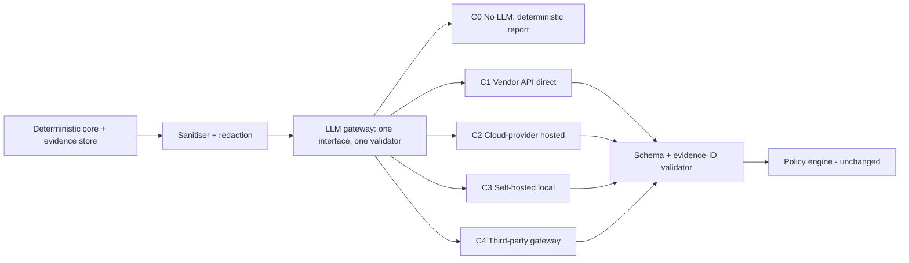
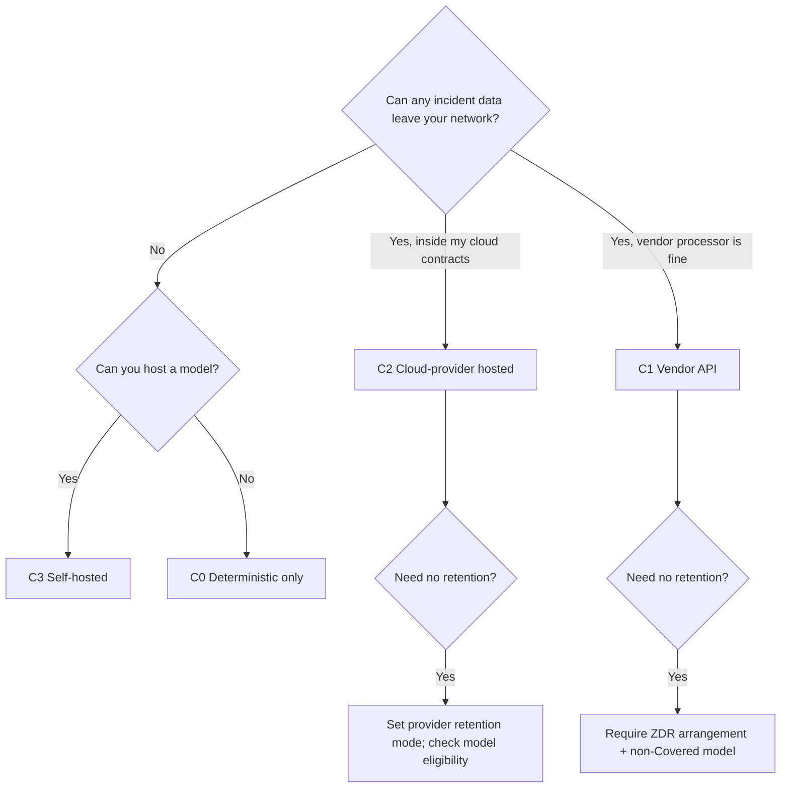

# LLM Delivery Channels (Hybrid Model)

**Audience:** engineers and clients choosing how Cloud Doctor's optional AI layer is delivered. **Status:** design proposal (nothing implemented). Facts cite the source register; "unverified" marks gaps.

> **Prototype scope (user decision 2026-10-31): C0 and C1 only.** C2, C3 and C4 are designed for clients but not implemented in the prototype; capability and quality claims about them remain hypotheses.

## NVIDIA NIM as the prototype's C1 provider (user has NIM API access)

**Classification:** NIM's hosted endpoint is a **C1 (vendor API)** channel behind the same gateway; a self-hosted NIM container would be **C3**.

**Verified from NVIDIA's own pages [S-122, S-123] and a direct check [S-124]:**
- Base URL `https://integrate.api.nvidia.com/v1`, `POST /v1/chat/completions`, Bearer-token authentication, described as "Compatible with OpenAI"; the public model listing is reachable and showed 85 models on 2026-10-31.
- The hosted chat request schema for the example model has `additionalProperties: false` and lists only `model, messages, temperature, top_p, tools, frequency_penalty, presence_penalty, max_tokens, stream, stop`; `max_tokens` default is 1024 and the maximum 4096. **`response_format`, `guided_json` and `nvext` are not in that schema**, and `tool_choice` is not in it either (although NVIDIA's own code templates send it when present — an unresolved discrepancy).
- The docs note that select models are available as downloadable containers with an NVIDIA AI Enterprise entitlement [S-122].

**Not found (unverified):** whether the hosted endpoint accepts or enforces `guided_json` / `response_format` [S-125 covers self-hosted NIM only and returned no text]; which models support tool calling; official rate limits and credits (third parties report ~40 requests per minute and ~1,000 credits [S-126, Tier 3]); data retention, logging, training-use and commercial-use terms for hosted prompts (not found; the terms page was not reachable).

**Design consequences (DESIGN DECISION):**
1. Add an **OpenAI-compatible adapter** to the gateway (base URL, model, key environment variable, timeout, `max_tokens` ≤ 4096).
2. **Do not rely on server-side schema enforcement.** The grounding validator already starts with client-side schema validation; the adapter asks for JSON only, parses, validates, retries once with the validator's error, and falls back to C0 (`evidence-grounding.md`). If the smoke test shows `guided_json` is enforced, enable it as an optimisation, not as a safety control.
3. **Do not rely on tool calling** until tested per model; the default is to pre-fetch evidence into the bundle.
4. Client-side **rate limiter** set below the unverified third-party figure (for example 30 requests per minute) with exponential back-off on HTTP 429.
5. **Data handling:** until NVIDIA's terms are read, treat the hosted endpoint as an external processor of unknown retention — send only the synthetic sandbox data, redacted, and never client data.
6. Run `tools/nim_smoke_test.py` with your own key (set in your shell, never pasted) to record capability flags per model; the gateway reads those flags.

## Why channels

The AI layer is optional and advisory (ADR-001, ADR-003). Clients differ on data sensitivity, budget, connectivity and compliance. So the LLM is **a swappable channel behind one interface**, chosen by client policy. The deterministic core works with every channel, including none.

## The five channels

| Channel | What it is | Where data goes | Typical client |
|---|---|---|---|
| **C0 — No LLM** | Deterministic diagnosis and templated report | Nowhere outside the deployment | Air-gapped, regulated, or cost-averse clients; also the permanent fallback |
| **C1 — Vendor API (direct)** | Model vendor's hosted API (e.g., Claude API) | To the vendor | Fastest start; clients comfortable with a vendor as data processor |
| **C2 — Cloud-provider hosted** | Same or other models via the client's cloud (e.g., Amazon Bedrock, Google Cloud, Microsoft Foundry) | Within the client's cloud tenancy/agreements | Clients standardised on a cloud with existing contracts and controls |
| **C3 — Self-hosted / local** | Open-weight model served locally (e.g., Ollama, vLLM) | Stays on the client's machines | Data-sovereignty or offline requirements |
| **C4 — Third-party gateway/aggregator** | Intermediary routing to multiple models | To the gateway and onward | Clients that already use one; **not researched**, treated as C1 plus an extra hop and extra contract |

## What the sources support (RESEARCH FINDING)

**C1 — vendor API [S-086]:** conversation content is not retained by default; the exception is "Covered Models" (Claude Fable 5.1, Mythos 5.1, Fable 5, Mythos 5) which require 30-day retention and are not ZDR-eligible unless authorised; retained data is not used for model training without express permission; Zero Data Retention is available by arrangement per organisation for eligible APIs. Standard retention periods are on separate policy pages **not read**; reports of longer retention for flagged content come from a summarised section — verify.

**C2 — cloud-hosted:**
- *Bedrock* [S-087]: retention is configurable per Region and account/project (`none`, `default`, `aws_review`, …); in `none` "no request or response data is written to durable storage by AWS or shared with the model provider"; model providers have no access to the AWS accounts that host models; for Claude Fable 5 and 5.1 the page says prompts and completions are retained within the AWS boundary for up to 30 days and may be reviewed by AWS and that `none` cannot be used. Whether Bedrock inference data is used for training, and default at-rest encryption of inference data, were **not found**. PrivateLink guidance on that page does not name runtime inference [S-088].
- *Google Cloud* [S-089]: Google states it will not use customer data to train or fine-tune models without prior permission; implicit caching is on by default (in-memory and durable tiers, both deleted within 24 hours; can be disabled); zero data retention requires specific actions per feature (e.g., do not enable request-response logging, set `store=false` for the Interactions API); some features cannot be ZDR.
- *Microsoft Foundry*: named in Anthropic's scope statement [S-086]; retention/training terms **not found**.
- Anthropic states which party is the data processor depends on the offering (Anthropic-managed vs. cloud-provider-managed) [S-086].

**C3 — self-hosted:**
- *Ollama* [S-090]: runs models locally, REST at `localhost:11434` (implied by base-URL table); structured output by giving a JSON schema in `format`; tool calling via `tools`; OpenAI-compatible base URL `http://localhost:11434/v1`; **Ollama's cloud mode does not support structured outputs**, and cloud requests need an API key — local vs. cloud mode must be pinned so data does not leave unintentionally. Hardware requirements were not found.
- *vLLM* [S-091]: OpenAI-compatible server (`/v1/chat/completions`, `/v1/models`, `/health`, `/metrics`…); `response_format` accepts `json_schema`; `structured_outputs` extra parameter exists; `parallel_tool_calls=false` limits tool calls. **Security:** `--api-key` only protects `/v1`, `/v2`, `/inference` prefixes, "Do not rely on `--api-key` alone"; dev-mode endpoints (e.g., `/collective_rpc`, LoRA load/unload) must not be exposed. Default port, hardware needs and tool-calling flags were not found.
- Model quality on RCA tasks for local open-weight models: **unverified** (no source read; must be measured).

## Capability matrix (what Cloud Doctor needs from any channel)

| Capability | C0 | C1 | C2 | C3 |
|---|---|---|---|---|
| Schema-constrained output | n/a | Yes (`strict` tools / JSON outputs) [S-054, S-055] | Per provider — unverified | Yes (Ollama `format`, vLLM `response_format`) [S-090, S-091] |
| Read-only evidence tool calls | n/a | Yes [S-037] | Per provider — unverified | Yes, model-dependent [S-090] |
| Data leaves client boundary | No | Yes | Within client cloud agreements | No (if local mode pinned) |
| Per-token cost | None | Yes (see `cost-performance.md`) | Yes (price not read) | None (hardware and operations instead) |
| Ops burden for client | None | Low | Low–medium | High (GPU/CPU hosting, patching, hardening) |
| Offline | Yes | No | No | Yes |

**Design rule:** the interface requires only "schema-constrained JSON in, schema-valid JSON out" plus optional read-only tool calls; channels advertise capability flags; if a channel lacks tool calling, Cloud Doctor pre-fetches evidence instead.

## Policy rules (DESIGN DECISION)

1. **Channel choice is client configuration, never the AI's choice.** A per-tenant policy file lists allowed channels, in order.
2. **Failover never loosens data rules.** On failure, the gateway may move only to an allowed channel *at least as restrictive*, otherwise to C0. A C3-only client never falls back to C1.
3. **Same pipeline for all channels:** same sanitiser, redaction, schema validator, evidence-ID validator and policy engine. No channel can bypass them.
4. **Data minimisation:** the evidence bundle excludes secrets, applies redaction, caps size, and classifies fields; stricter channels (C1/C2) can be configured to send **summaries without raw log lines**.
5. **Provenance:** every AI output records channel, model ID, parameters, prompt hash, token counts and latency in the audit log.
6. **Pin modes explicitly** (e.g., Ollama local only; cloud ZDR/retention mode set; model not in a 30-day-retention class unless the client accepts it).
7. **Budgets per channel** (tokens/incident, calls/incident, daily cap) with hard stop to C0.
8. **Secrets** for C1/C2/C4 live only in the gateway process; none in the AI zone or sandbox.

## Client decision guide

## Evaluation per channel (pending)

The same harness compares channels on top-k RCA accuracy, unsupported-claim rate, hallucination rate, latency and cost. **No result exists.** Expect (HYPOTHESIS) that local models are cheaper but less accurate and less reliable at schema/tool use; this must be measured, and the product should say so to clients.

## Risks and open items

- Retention and training terms change; treat the table as of 2026-10-31 and re-check at contract time.
- Provider pricing for C2/C4 not read.
- Local-model hardware sizing and quality unmeasured.
- Legal/compliance review is out of scope of this document.

## References

S-037, S-054, S-055, S-083–S-091 in `docs/_sources/register.md`.
