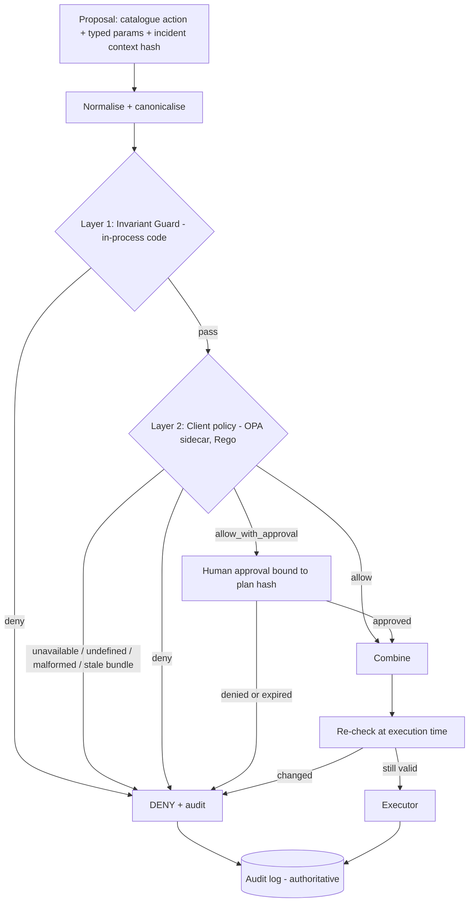

# Policy Engine — Hybrid Architecture

**Status:** design (ADR-005, Proposed; direction set by the user on 2026-10-31: a hybrid policy engine). Nothing implemented; no tests run.

## Problem

Every proposed action (from rules or from an LLM) must pass a policy decision before the executor sees it. The policy must satisfy two pressures that pull apart:

1. **Safety invariants** that must never be weakened — by a client, a misconfigured file, or an unavailable service.
2. **Client-specific rules** (change freezes, approval requirements, per-service permissions, per-channel rules) that differ per client and should be editable without redeploying code.

One mechanism serves neither well: code-only policy is rigid, Rego-only policy makes the safety floor depend on a separate service and its configuration. So the engine is **hybrid: two layers, each with a different owner and failure mode.**

## What the sources support (RESEARCH FINDING)

- OPA decouples decision-making from enforcement; software queries it with structured input and receives structured output [S-034]. Deployment: most often a sidecar, less commonly an external service; integration via REST, Go SDK or Wasm [S-052].
- **Undefined decisions:** the REST Data API returns **200 without a `result` key** when the path is undefined (`{}`) [S-098, verbatim]. The Wasm page says callers should check for an empty result set to detect an undefined decision [S-097, verbatim]. *Inference:* a caller that treats HTTP 200 as "allow" would fail open; the caller must test for `result`.
- **Bundles:** a bundle failing signature verification or activation leaves the previous bundle active, reporting the failure through status and logs; a bundle with a top-level `keys` setting but no `signing` block is still activated unsigned, so enforcement requires a `signing` block; persisted bundles allow startup from the last activated bundle when the bundle server is unreachable if `persist` is enabled [S-099, verbatim]. Health checks including bundle state are recommended with multiple bundle sources [S-099]; the `/health?bundles` details are summary-level [S-098].
- **Decision logs** are best-effort (events can be dropped above a rate limit; non-2xx uploads are requeued) [S-053], so they are not the audit record.
- **Wasm:** built-ins such as `http.send` are not natively supported [S-097]. Python Wasm SDKs found in search are community-maintained and one appeared stale [S-100, unverified]; therefore the prototype does not depend on in-process Wasm from Python.
- OWASP names excessive agency and improper output handling as LLM risks [S-036].

## Architecture



### Layer 1 — Invariant Guard (in-process, code, non-overridable)

Owned by the engineering team; changed only by code review and tests. No network dependency. Rules (DESIGN DECISION):

| ID | Invariant |
|---|---|
| I-01 | Action must be in the catalogue; params must match the typed schema and bounds (e.g., replica cap) |
| I-02 | Target must be on the sandbox allowlist and labelled as sandbox; environment must equal sandbox |
| I-03 | Risk class ceiling: **high is never executable**; medium requires approval |
| I-04 | Attempt budget, cooldown, and circuit-breaker state respected (`remediation-loops.md`) |
| I-05 | Evidence precondition: cited evidence exists, is fresh, and diagnosis passed the grounding validator |
| I-06 | No action parameter may be derived from free-text log content outside enumerations |
| I-07 | Dependency-aware rule: no restart of a victim whose confirmed cause is a down dependency unless the plan addresses the cause |
| I-08 | Any internal error, missing input, or timeout ⇒ deny |

**Placement (ADR-007, accepted):** Layer 1 is a standard-library-only Python package (`invariants`) imported by two processes: the control plane (decision-time dry run) and a separate Python **actuator** process (execution-time re-check, then command execution). There is one implementation and a second enforcement point that does not depend on the control plane being correct.

### Layer 2 — Client Policy (OPA/Rego, configurable, restrictive-only)

Owned by the client or operator; deployed as a **signed bundle** to a local OPA server (sidecar). Typical rules: change-freeze windows, per-service permissions, required approver roles, stricter confidence thresholds, per-tenant LLM channel permissions (e.g., whether C1 may be used), maximum concurrent actions, working-hours approval rules.

Layer 2 receives a **minimised input** (action, params, target, risk class, confidence, counters, tenant, channel, time) — never raw logs or LLM text, so injected content cannot reach the policy engine.

### Composition rule (the "hybrid" contract)

```text
final = deny                  if L1 = deny
      = deny                  if L2 is unavailable, malformed, undefined (no `result`), or bundle state not healthy
      = deny                  if L2 = deny
      = allow_with_approval   if L1 or L2 requires approval (the strictest approver requirement wins)
      = allow                 otherwise
```

**Layer 2 can only tighten, never loosen:** a permissive or buggy Rego rule cannot override Layer 1 because the composition is a conjunction. This is the property that makes the engine safe to hand to clients.

### Decision record (audit)

```json
{
  "decision_id": "DEC-0031",
  "plan_id": "PL-0002",
  "plan_hash": "sha256:…",
  "l1": {"result": "pass", "rule_ids": ["I-01","I-02","I-03"]},
  "l2": {"result": "allow_with_approval", "rule_ids": ["C-APPROVE-MED"], "bundle_revision": "…", "bundle_signed": true},
  "final": "allow_with_approval",
  "invariants_version": "git:…",
  "decided_at": "…"
}
```

Approvals are bound to `plan_hash`; any change to the plan invalidates them. Time-of-check/time-of-use is handled by re-evaluating immediately before execution and by approval expiry.

## Failure behavior (fail closed)

| Condition | Behavior |
|---|---|
| OPA process down / timeout | Deny; incident continues with recommendation only; alert |
| HTTP 200 without `result` | Treated as undefined → deny [S-098] |
| Bundle not activated / signature failure / stale beyond limit | Deny (health check including bundle state) [S-099, S-098] |
| Layer 1 internal error | Deny |
| Audit log write fails | Deny (cannot execute unauditable action) |
| Conflicting layers | Strictest result wins |

## Deployment choice (provisional)

- Prototype: **OPA as a localhost REST sidecar** (full-featured, official; avoids the unverified Python Wasm SDKs) [S-052, S-100].
- Bundles: signed with an explicit `signing` block (not only `keys`), persistence enabled for restart resilience, bundle revision recorded in every decision [S-099].
- Policy changes: pull request + Rego unit tests + signature + rollout; Layer 1 changes go through code review.
- A **Layer-2-less mode** (Layer 1 only) is supported for clients with no custom rules; it is the default and is the safe subset.

## Test plan (all pending)

- Layer 1: unit and property tests per invariant; adversarial proposals (unknown action, oversized params, non-sandbox target, parameter smuggling).
- Layer 2: Rego tests per rule (verify the Rego testing workflow before relying on it — not read); conformance suite shared with a reference implementation.
- Composition: matrix of L1×L2 outcomes; confirm L2 cannot loosen L1.
- Failure injection: OPA down, slow, returning `{}`, bundle signature failure, stale bundle, audit DB down.
- Security: injected log corpus (must never alter decisions), forged approvals, replayed approvals.

## Alternatives considered

| Option | Why not (alone) |
|---|---|
| Code-only | No client-editable policy; weaker "policy-as-code" story |
| OPA-only | Safety floor depends on a separate service, bundle state, and correct Rego |
| Kubernetes RBAC/admission | Requires Kubernetes; RBAC permissions are additive and do not express plan-level rules [S-041] |

## Risks and open items

- Two layers double the test surface and risk inconsistent semantics; mitigated by the single composition rule and shared decision schema.
- OPA fail-closed is built by the caller, not provided by OPA docs [S-052 found no statement].
- Health-endpoint semantics (`/health?bundles`) and Rego test tooling need verification from the full pages.
- Policy expressiveness for approver roles depends on the API's authentication design (open item in `api-architecture.md`).

## References

S-034, S-036, S-041, S-052, S-053, S-097–S-100 in `docs/_sources/register.md`.
