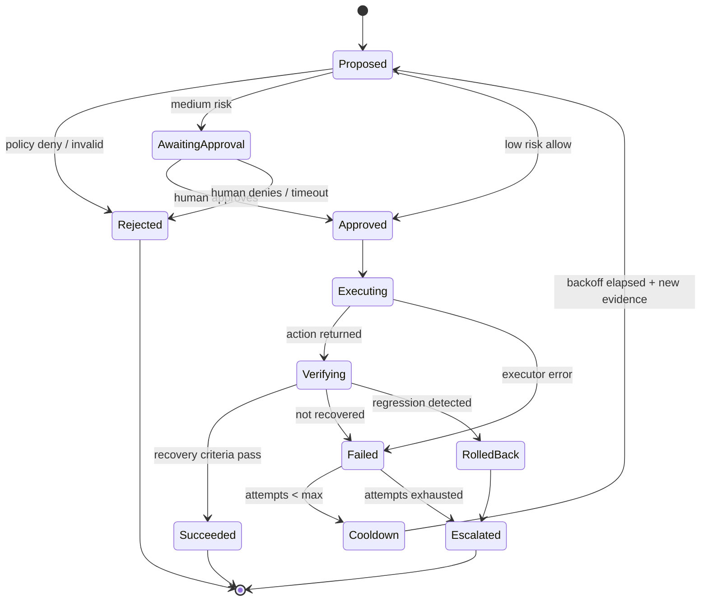

# Remediation Loops and the Remediation State Machine

## Abstract

Automated restarts can oscillate indefinitely. This document collects sourced mechanisms for bounding repetition and defines the remediation state machine.

## Research Findings (RESEARCH FINDING)

- **Circuit breaker** [S-039, 2014]: wraps a protected call; after failures reach a threshold it opens and calls fail without invoking the protected operation; a **half-open** state lets a trial call decide reset. Author notes operators should be able to trip or reset breakers and that state changes should be logged. More advanced variants use error rates or different thresholds per error type. The numeric values in the article are code examples, not recommendations.
- **Kubernetes restart behavior** [S-019, summary-level read]: restarts use exponential back-off (10s, 20s, 40s… capped at 300s), reset after 10 minutes of healthy running; `CrashLoopBackOff` marks the loop. Precedent that platforms themselves bound restart loops.
- **Liveness cascade caution** [S-018]: incorrect liveness probes cause restarts under high load and shift load onto remaining pods.
- **Google SRE** [S-002]: a page needing only a robotic response is a candidate for automation; yet pages should concern novel problems, and repeated rote responses signal a need to fix the cause.

## Design (DESIGN DECISION)

Per (incident, service, action) tracking, enforced by deterministic code outside the LLM:

| Guard | Rule (values TBD from experiments) |
|---|---|
| Max attempts | N per incident |
| Cooldown | exponential backoff between attempts |
| Action budget | M actions per time window per service/global |
| Strategy change | After a failed attempt the planner may not re-propose the same action/target unless new evidence changes the diagnosis |
| Circuit breaker | Opens after repeated failed remediations or regression; reset only by human |
| Regression abort | If post-action health is worse than pre-action, stop and escalate |
| Escalation | Terminal state with report; no further autonomous action |

## Cloud Doctor Application

EXP-10 (failed remediation) and a restart-loop scenario test that the breaker opens and the system escalates without a fourth restart. Metric: remediation loops (target zero beyond the configured max).

## Limitations / Open Questions

- Backoff values and attempts are untuned.
- Rollback semantics differ per action (restart has no rollback; scale does).

## References

S-002, S-018, S-019, S-039 in `docs/_sources/register.md`.
