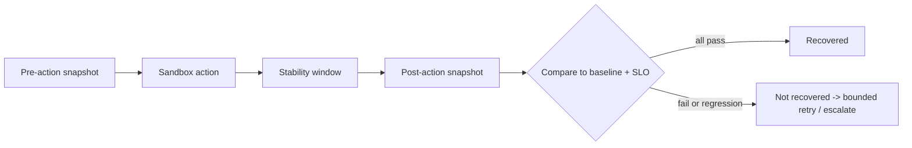

# Service Health Model

## Abstract

Defines how Cloud Doctor represents service health and what "recovered" requires. Kubernetes probe semantics (S-018) inform readiness/liveness design; SRE golden signals (S-002) inform user-facing health.

## Research Findings (RESEARCH FINDING)

Kubernetes probes [S-018; defaults and cautions read verbatim from the final slice of the page]:

- Startup, liveness, readiness probes. Liveness decides when to restart a container; readiness decides when a container accepts traffic. Failing readiness removes the pod from service endpoints without restarting it. If no probe is defined the result is Success.
- Defaults: `initialDelaySeconds` 0, `periodSeconds` 10, `timeoutSeconds` 1, `successThreshold` 1 (must be 1 for liveness/startup), `failureThreshold` 3.
- Caution (verbatim in substance): liveness probes must indicate truly unrecoverable failure; incorrect ones "can lead to cascading failures" (restarts under high load, increased load on remaining pods). For back-end dependencies, the page suggests the readiness probe additionally checks the required services while liveness reflects the app itself.
- Restart policy default `Always`; restart back-off 10s, 20s, 40s… capped at 300s, reset after 10 minutes of running [S-019, summary only — verify].

Golden signals [S-002]: latency, traffic, errors, saturation; separate failed- from successful-request latency.

**Interpretation:** a running container can still be unready or serve errors, so "container running" cannot define recovery. Reflexive restarts of a container that fails only because a dependency is down are unhelpful and can amplify load.

## Health model (DESIGN DECISION)

Per-service health state, computed deterministically:

```text
HEALTHY | DEGRADED | UNHEALTHY | UNKNOWN
```

| Input | Role |
|---|---|
| Availability / error rate (SLI) | Primary |
| Latency percentile (p95/p99, successful and failed separately) | Primary |
| Throughput vs. baseline | Context (traffic drop can mean upstream failure) |
| Saturation (CPU, memory, connections, queue depth) | Early warning and evidence |
| Restart frequency | Evidence; loop indicator |
| Readiness / liveness | State confirmation |
| Dependency health | Cause attribution; not an automatic child-state override |
| Telemetry freshness | Missing data ⇒ `UNKNOWN`, never `HEALTHY` |

Hysteresis: transitions into worse states need persistence; transitions back need a stability window (value TBD, OQ-06).

## Recovery success (DESIGN DECISION)

```text
Recovery = readiness OK
        AND dependencies healthy
        AND error-rate SLI within SLO over the stability window
        AND latency SLI within SLO over the stability window
        AND synthetic business transaction succeeds
        AND no regression in other services vs. pre-action baseline
```

Evidence for each term is captured as `EV-###` records before and after the action.



## Limitations / Open Questions

- Probe default values apply to Kubernetes; if the sandbox is Docker Compose, equivalent health checks need separate sourcing.
- Stability window length; baseline definition under synthetic load.

## References

S-002, S-018, S-019 in `docs/_sources/register.md`.
