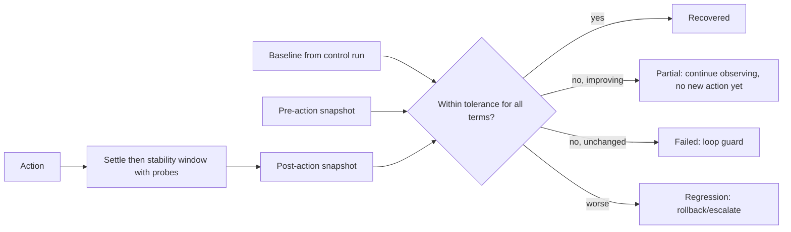

# Recovery Verification (including before/after analysis and failure outcomes)

**Status:** design. Consolidates the planned `recovery-verification`, `before-after-analysis` and `recovery-failure` documents. Window lengths and tolerances are **TBD from experiments**; no values are claimed.

## Problem

"Container running" is not recovery. Recovery must be demonstrated from signals that the remediation cannot fake, over a period long enough to catch relapse.

## Research basis (RESEARCH FINDING)

- Readiness decides whether a container accepts traffic and may check dependencies; liveness decides restarts and can cause cascading failures if misdesigned [S-018].
- User-facing health is expressed by golden signals and SLIs; error and latency are separate from "up" [S-001, S-002].
- Alert resolution needs persistence: `keep_firing_for` exists to avoid flapping and false resolution on missing data [S-005]; long reset times in alerting confuse operators [S-003].
- Restart back-off and reset-after-healthy-period exist in Kubernetes as precedent for judging health over time [S-019, summary].
- Prometheus data is sampled and may be absent; `absent()` detects missing series [S-007, S-044].

## Definition (DESIGN DECISION)

```text
Recovered(t_end) =
      Readiness(service) true over the window
  AND Dependencies healthy over the window
  AND ErrorSLI within SLO over the window
  AND LatencySLI within SLO over the window
  AND SyntheticTransaction succeeds at every probe in the window
  AND NoRegression(other services vs. pre-action baseline)
  AND TelemetryFresh (no UNKNOWN in the window)
```

If any term is `UNKNOWN`, the result is **not recovered** (fail closed).

## Verification inputs

| Input | Source | Why |
|---|---|---|
| Pre-action snapshot | Evidence store, taken before the action | Baseline for comparison; preserves evidence destroyed by restarts |
| Telemetry SLIs | Prometheus/Loki | Standard signals |
| **Independent probes** | Cloud Doctor's own synthetic transactions through the gateway | Not dependent on the telemetry the sandbox services emit; reduces the effect of forged metrics (TM-02) |
| Dependency state | Topology + health probes | Cause attribution |
| Post-action snapshot | Same queries as pre | Like-for-like comparison |

## Window and thresholds (design, values TBD)

```text
stability_window ≥ max( k × scrape_interval,
                        rule_for + keep_firing_for,
                        k2 × probe_interval )
```

with `k`, `k2` chosen so that at least N consecutive samples/probes are healthy; N set from experiment variance. The window starts when the executor returns, after a short settling period for restarts. Tolerance bands come from the **baseline distribution** recorded in the control run, not from a single value.

## Before/after comparison

For each SLI: compute the pre-fault baseline (from the control), the degraded value (pre-action), and the post-action value; report all three with the window. Regression check: every other service's SLIs and saturation compared with baseline; any breach counts as regression and triggers rollback/escalation.



## Outcome taxonomy

| Outcome | Meaning | Next |
|---|---|---|
| Recovered | All terms hold through the window | Close incident; report; record "mitigated" vs. "root cause confirmed" separately |
| Partial | Some terms recovered, others not | Hold; diagnose residual; no repeated identical action |
| Failed | No improvement | Cooldown, new evidence required, attempt budget [remediation-loops.md] |
| Regression | Worse than pre-action or other services degraded | Roll back if defined; escalate |
| Relapse | Recovered then degraded again within a relapse window | Reopen with link to earlier incident; treat as a persistent cause (e.g., EXP-04 memory leak) |
| Unverifiable | Telemetry/probe unavailable | Not recovered; alert; escalate |

## Failure modes of verification itself

False recovery (window too short, probe too shallow, forged metrics) and false failure (noisy probe, slow warm-up). Mitigations: multi-signal AND, independent probes, repeated probes, baseline-derived tolerances, relapse window. FM-15 in the FMEA covers this.

## Metrics

Verified TTR, false-recovery rate (declared recovered but fault still present per ground truth), false-failure rate, relapse rate, verification latency, regression detection rate in EXP-10. **All pending.**

## Limitations / Open questions

- Window length and N (OQ-06); synthetic probes must represent a real "business transaction" in the simulated app.
- Docker Compose health checks differ from Kubernetes probes; if Compose is chosen, equivalents must be defined and sourced.
- Ground truth for "fault still present" comes from the harness (S-027-style steady-state definition).

## References

S-001–S-003, S-005, S-007, S-018, S-019, S-027, S-044.
