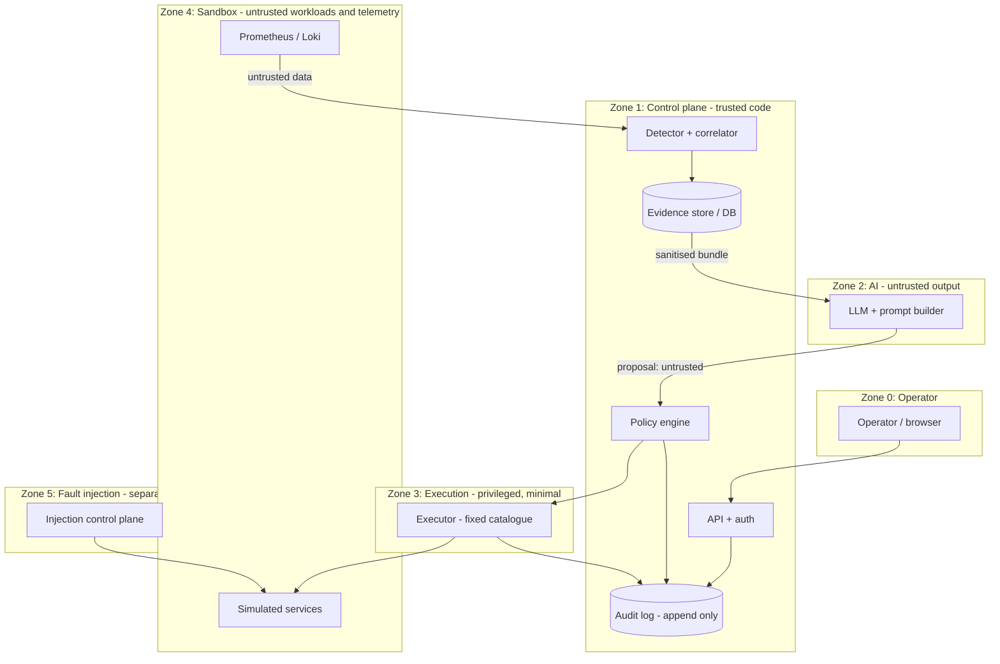

# Threat Model

**Status:** Draft v0.1. Scope: the Cloud Doctor control plane and its sandbox. Threats are hypotheses derived from sourced guidance (S-030–S-038), not observed attacks.

## Assets

Sandbox integrity; host integrity; policy and audit integrity; credentials/secrets; diagnosis correctness; availability of Cloud Doctor.

## Trust boundaries

Key rules: the LLM zone has no path to the executor, the Docker daemon, secrets or the injector; only the policy engine's approved, typed requests reach the executor; telemetry crosses into the control plane as data only.

## Threats (STRIDE-flavoured)

| ID | Zone | Threat | Impact | Primary controls | Residual risk |
|---|---|---|---|---|---|
| TM-01 | 4→2 | Prompt injection via logs (T-AI-1) | Misleading diagnosis, attempted action | Untrusted-content handling [S-038], schema output, policy gate | Misleading explanation to human |
| TM-02 | 4→1 | Telemetry poisoning (forged metrics/logs) causing false incident or false recovery | Wrong action; false "recovered" | Cross-source corroboration, synthetic probes from Cloud Doctor itself, anomaly limits | Coordinated poisoning of several sources |
| TM-03 | 2→3 | LLM-generated command injection / out-of-catalogue action | Arbitrary execution | No free-form commands; typed catalogue; allowlisted targets | Bugs in validators |
| TM-04 | 3 | Executor controls a Docker daemon (root-equivalent on whichever host runs it; Tier 3 sources agree [S-075, S-076]) | Compromise of the daemon's host | **Proposed:** the daemon is private to a MicroVM, not the host's [S-093]; executor limited to the fixed catalogue; control channel into the VM restricted | Medium → lower if spikes confirm no host mounts and no host socket; the VM control channel (`sbx`/vendor API) becomes the privileged path |
| TM-13 | 3,4 | Host workspace exposed to the sandbox (default read-write virtiofs mount) [S-093] | Sandbox-originated edits to host files (e.g., git hooks, scripts) executed later on the host | Clone or mountless mode; never mount the Cloud Doctor repo, policy files or secrets | Low if enforced; verify (spike S5) |
| TM-14 | 3,4 | Overbroad default network allowlist from the sandbox proxy [S-093] | Unintended egress or exfiltration from sandbox workloads | Deny-by-default preset, explicit allowlist, review `policy ls`; test (spike S6) | Low–medium |
| TM-16 | 0 | Dashboard renders untrusted evidence (log lines, error text) that may contain HTML/script, or a UI server layer holds logic or credentials | XSS against an operator who can approve actions; approval abuse | Render evidence as escaped text only, strict content security policy, no business logic or authorization in the UI layer (API enforces it), approvals require API-side authentication and plan-hash binding | Low if enforced; to verify with UI security tests (framework guidance not yet read) |
| TM-15 | 1 | Layer-2 (OPA) misconfiguration or outage | Unauthorized or blocked actions | Hybrid policy: Layer 1 invariants non-overridable, Layer 2 can only tighten, fail closed [policy-engine.md] | Policy bugs in Layer 1 |
| TM-05 | 4 | Container escape to host | Host compromise | Default capability restrictions, no `--privileged`, no host mounts [S-030, S-032] | Kernel-level escapes out of scope |
| TM-06 | 5 | Injector API abuse (Toxiproxy API unauthenticated by default) [S-028] | Fault injection against arbitrary upstreams | Bind to isolated network, enable auth token | Low if isolated |
| TM-07 | 1 | Policy bypass or tampering | Unauthorized action | Default-deny, policy as read-only artifact, tests, hash recorded in audit | Policy bugs |
| TM-08 | 1 | Audit log tampering | Loss of accountability | Append-only store, hash chain (planned) | Insider with DB access |
| TM-09 | 0–1 | Unauthorized operator approves or triggers action | Abuse of remediation | Authentication, roles, per-action authz, idempotency keys | Credential theft |
| TM-10 | 2 | Secret leakage to LLM provider | Credential exposure | Redaction, no secrets in sandbox logs by design | Pattern misses |
| TM-11 | 1,2 | DoS via log flood / token exhaustion | Cloud Doctor blind or costly | Rate limits, bundle caps, token budgets, backpressure | Moderate |
| TM-12 | 1 | Remediation abuse: repeated actions as a DoS on the sandbox | Self-inflicted outage | Loop guards [remediation-loops.md] | Low |

## Verification plan

Negative tests per threat: injected log corpus (TM-01), forged metric (TM-02), crafted action payloads (TM-03/07), non-sandbox target (FR-010), unauthorized caller (TM-09). Results: **pending**.

## Open Questions

Rootless Docker or dedicated VM for the sandbox daemon; secrets management approach; whether to use mutual authentication between zones.

## References

S-028, S-030, S-031, S-032, S-036, S-038 in `docs/_sources/register.md`.
