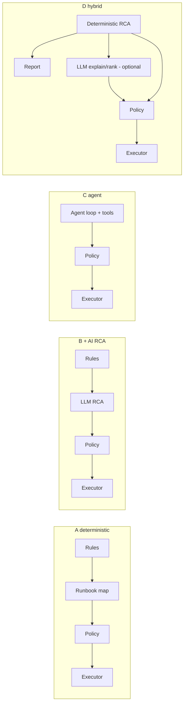

# Architecture Options

**Status:** Draft. Comparison is qualitative and argued from the research documents; no option has been implemented or measured. The recommendation is **proposed**, subject to Gate G1.

## Options

### A — Rule-based monitoring + deterministic remediation

Detector → rule-based RCA → runbook mapping → policy → executor → verifier. No LLM.

### B — Rule-based monitoring + AI-assisted RCA

Detector and evidence store are deterministic; an LLM ranks/explains hypotheses and suggests actions; deterministic policy gates execution. Remediation executes only catalogue actions.

### C — AI-agent investigation + policy-controlled remediation

An LLM agent plans investigation, calls telemetry tools iteratively (retrieval by tool use [S-024, S-037]), diagnoses and proposes actions; policy gates execution.

### D — Hybrid

A deterministic core always produces a complete diagnosis and report (A). An optional AI layer adds explanation, cross-signal hypotheses and recommendations (B), constrained to evidence IDs. Bounded tool-based evidence requests (from C) are allowed read-only and budgeted.

## Comparison (qualitative; evidence-based where cited)

| Criterion | A | B | C | D |
|---|---|---|---|---|
| Works with LLM down | Yes | Degraded (RCA lost) | No | Yes (core principle) |
| Explainability | High (rules) | Medium; needs evidence validator | Lower; reasoning-trace failures documented [S-026] | High core + validated narrative |
| Handles novel faults | Poor | Better (hypothesis generation) | Potentially best, unproven here | Moderate |
| Injection / excessive-agency exposure [S-036] | Minimal | Moderate | Highest (many tool calls over untrusted text) | Moderate, bounded by design |
| Cost / latency | Lowest | Moderate | Highest (iterative calls) | Moderate, budgeted |
| Implementation effort | Lowest | Medium | Highest | Medium-high |
| Testability / reproducibility | Highest | Medium (nondeterminism) | Lowest | High core, medium AI |
| Demonstrates challenge requirement ("identifies likely root causes") | Rule coverage only | Yes | Yes | Yes |
| Risk of circular evaluation (designer writes rules and scenarios) | High | Medium | Low-medium | Mitigated by a no-LLM baseline and unseen scenarios |

## Recommendation (PROPOSED — ADR-001)

**Option D.** Rationale:

1. The challenge asks for root-cause identification with evidence; deterministic RCA covers known fault classes, and the LLM adds value only where evidence is ambiguous — this is **a hypothesis (H-AI-1) to be tested** against option A as baseline.
2. Published causal-RCA methods do not generalize reliably [S-021] and LLM RCA shows documented reasoning failures [S-026], which argues against making either authoritative.
3. Safety: bounded agency and process separation reduce the OWASP-listed risks [S-036].
4. Requirement FR-006 (works without LLM) rules out B and C as primary architectures.

**Falsification conditions (reconsideration):** if experiments show the LLM adds no measurable accuracy or explanation benefit over deterministic ranking, drop to A with a templated report; if deterministic rules cannot cover ambiguous scenarios and the LLM does materially better with zero unauthorized actions, consider expanding the evidence-request budget.

## Limitations

Scores are reasoned, not measured. Option C was judged from papers read at abstract level only [S-024, S-026].

## References

S-021, S-024, S-026, S-036, S-037 in `docs/_sources/register.md`.
