# Data Architecture

**Status:** Draft design. Database choice (PostgreSQL) provisional; TimescaleDB not justified — raw time series stay in Prometheus, and Cloud Doctor stores only incident-scoped evidence snapshots (**HYPOTHESIS**: volume stays small at this scale; to measure).

## ER diagram

```mermaid
erDiagram
    SERVICE ||--o{ DEPENDENCY : "depends_on"
    SERVICE ||--o{ ALERT : emits
    INCIDENT ||--o{ ALERT : groups
    INCIDENT ||--o{ EVIDENCE : collects
    INCIDENT ||--o{ TIMELINE_EVENT : has
    INCIDENT ||--o{ HYPOTHESIS : proposes
    HYPOTHESIS ||--o{ HYPOTHESIS_EVIDENCE : cites
    EVIDENCE ||--o{ HYPOTHESIS_EVIDENCE : supports_or_contradicts
    INCIDENT ||--o{ REMEDIATION_PLAN : recommends
    REMEDIATION_PLAN ||--o{ POLICY_DECISION : evaluated_by
    REMEDIATION_PLAN ||--o{ ACTION_EXECUTION : executes
    ACTION_EXECUTION ||--o{ VERIFICATION_RESULT : verified_by
    INCIDENT ||--o{ AUDIT_LOG : records
    EXPERIMENT_RUN ||--o{ INCIDENT : produces

    SERVICE {
        uuid id
        string name
        string tier
    }
    DEPENDENCY {
        uuid service_id
        uuid depends_on_id
        string kind
    }
    ALERT {
        uuid id
        uuid service_id
        string rule
        timestamp fired_at
        timestamp resolved_at
        string state
    }
    INCIDENT {
        uuid id
        string state
        timestamp opened_at
        timestamp closed_at
        string severity
        string outcome
    }
    EVIDENCE {
        string evidence_id
        uuid incident_id
        string source
        string type
        uuid service_id
        timestamp observed_at
        timestamp collected_at
        string query
        json payload
        string hash
        boolean untrusted
    }
    TIMELINE_EVENT {
        uuid id
        uuid incident_id
        timestamp event_time
        timestamp collected_at
        string kind
        string ref_evidence_id
    }
    HYPOTHESIS {
        uuid id
        uuid incident_id
        string cause_id
        float confidence
        string status
        string origin
    }
    HYPOTHESIS_EVIDENCE {
        uuid hypothesis_id
        string evidence_id
        string relation
    }
    REMEDIATION_PLAN {
        uuid id
        uuid incident_id
        string action_id
        json params
        string risk_class
        string origin
    }
    POLICY_DECISION {
        uuid id
        uuid plan_id
        string decision
        string rule_ids
        string policy_hash
        timestamp decided_at
    }
    ACTION_EXECUTION {
        uuid id
        uuid plan_id
        string idempotency_key
        timestamp started_at
        timestamp ended_at
        string result
    }
    VERIFICATION_RESULT {
        uuid id
        uuid execution_id
        string verdict
        json checks
        timestamp window_start
        timestamp window_end
    }
    AUDIT_LOG {
        bigint seq
        uuid incident_id
        string actor
        string event
        json detail
        string prev_hash
        string hash
    }
    EXPERIMENT_RUN {
        uuid id
        string scenario_id
        json metadata
        timestamp injected_at
    }
```

## Notes

- `EVIDENCE.evidence_id` is human-readable (`EV-001`) and unique per incident; `observed_at` and `collected_at` are separate to handle skew. `payload` for logs is flagged `untrusted`.
- `HYPOTHESIS.status` ∈ {candidate, supported, refuted, confirmed}. `confirmed` is set only by the verification rule, or by ground truth in experiments. `origin` ∈ {rule, llm}.
- `HYPOTHESIS_EVIDENCE.relation` ∈ {supports, contradicts}.
- `AUDIT_LOG` is append-only with a hash chain (planned).
- `ACTION_EXECUTION.idempotency_key` prevents duplicate execution.

## Indexes (planned)

`evidence(incident_id, evidence_id)`, `timeline_event(incident_id, event_time)`, `alert(service_id, fired_at)`, `incident(state, opened_at)`, `audit_log(incident_id, seq)`.

## Retention

Incident records and audit logs kept for the project; raw telemetry retention governed by Prometheus/Loki settings (unspecified). Evidence payloads store query results, not raw streams.
