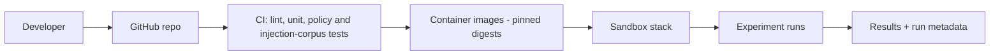
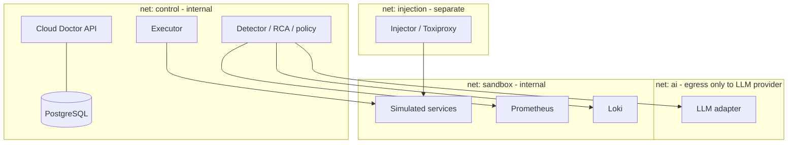
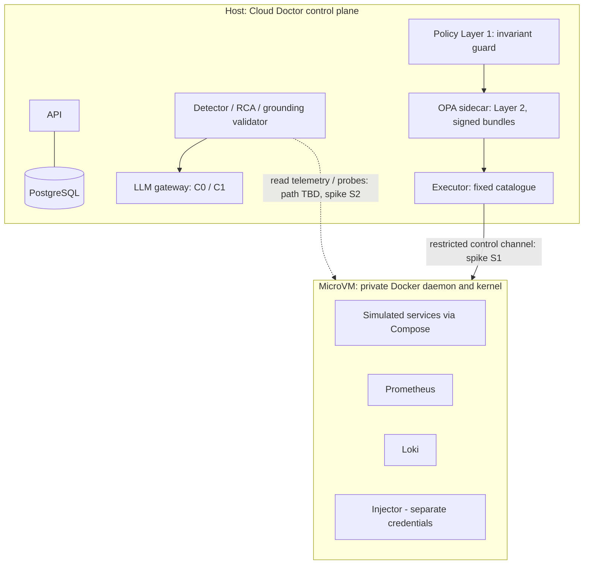

# Deployment Architecture

**Status:** Design, provisional on ADR-004. Nothing deployed.

## Environments

| Environment | Purpose |
|---|---|
| Developer workstation / dedicated VM | Runs the sandbox stack and Cloud Doctor |
| CI (GitHub) | Lint, unit tests, policy tests, schema tests, container builds; may run a reduced scenario smoke test |

No production or cloud environment is used.

## Delivery pipeline

## Runtime layout (provisional, Option A sandbox)

Rules: networks are separate Compose networks; sandbox network is `internal: true` so workloads have no external egress [S-033]; the LLM adapter is the only component with outbound internet access, and has no route to the sandbox or executor; the injector API is not reachable from Cloud Doctor components; the executor reaches the container runtime through a rootless or VM-isolated daemon (open, see ADR-004) and never from the AI network.

Caveat: Compose network semantics beyond those read (published ports, host reachability on internal networks) are unconfirmed [S-033].

## Runtime layout update — MicroVM sandbox (provisional, ADR-004 Update 3)

Rules: no host Docker socket anywhere; the VM workspace uses clone or mountless mode (no read-write host mount); the VM's network policy is deny-by-default; the LLM gateway is the only component with outbound access to an LLM vendor (C1) and holds the key; the injector is not reachable from Cloud Doctor components. The Compose stack stays portable so it can run in a plain dedicated VM as the fallback. How the host reaches in-VM Prometheus/Loki and the gateway endpoint is **unresolved** and is spike S2.

## Configuration and secrets

Secrets only in environment/secret files outside the repository; none in the sandbox; LLM key accessible only to the adapter. A secrets-management document is pending.

## Reproducibility

Pinned image digests, versioned scenario configs, recorded run metadata (NFR-006). One-command bring-up and teardown targets are planned.

## Open questions

Dedicated VM vs. rootless daemon; Kind alternative; persistent volumes policy for Postgres/Prometheus in experiments (reset between runs).
