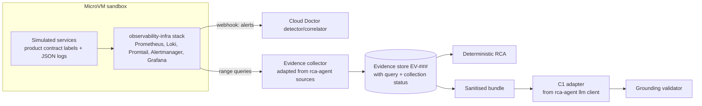

# Reuse From Existing Projects: Linux-RCA-Platform and observability-infra

**Status:** analysis of two sibling repositories the user owns. Based on reading the files listed under "Evidence read"; anything not listed was **not** read. These are *project facts* (what the code does), not external sources, so they are not in the source register. No code from either repo was modified.

## Evidence read

- **Linux-RCA-Platform** (`/home/hackycoder/mca_labs/Linux-RCA-Platform`, 6 commits): `prototypes/rca/agent/cmd/rca-agent/main.go`, `internal/llm/anthropic.go`, `internal/sources/prometheus.go`, `internal/sources/loki.go`, `docs/Phase-1.md`, `docs/Phase-1-Review-Plan.md`, `docs/Phase-1-Research-Review-Plan.md` (first 160 lines), `prototypes/networking/observability/docker-compose.yml`, file listing. The `.env` file was **not opened**; only its key name was listed (`ANTHROPIC_API_KEY`, git-ignored, not tracked).
- **observability-infra** (`/home/hackycoder/mca_labs/observability-infra`, 10 commits): `README.md` (first 180 lines), `docker-compose.observability.yml`, `scripts/observability.sh`, `core/prometheus/rules/alerts.infra.yml`, `recording.rules.yml`, `core/alertmanager/alertmanager.yml.tmpl`, `core/otel-collector/config.yaml`, the product pack's `alerts/slo.yml`, `docs/learning/06-alerting-verification.md`, `07-hardening-checklist.md`, `.gitignore`, file listing.
- **Not read:** netmon collector/exporter Go code, Grafana dashboards, Loki/Promtail/Tempo configs, other product-pack alert files, backup script, remaining learning modules.

> **Correction (after reading the documentation in full):** observability-infra's own learning docs state that its phases are "done" only in the sense that configuration exists and that the stack "has never actually been brought up and checked end-to-end." Treat it as a configured, pinned base that still needs verification, not as a proven stack. See `docs/00-overview/prior-work-and-lessons.md` for the documentation-based findings (missing scenarios, expected-state handling, topology-as-code, MicroVM risks such as `/dev/kmsg` and `network_mode: host`).

## What each project is

**Linux-RCA-Platform:** a 6-month research roadmap plus prototypes: a Go network-monitor (`net-monitor`: bandwidth, connections, probes, packet capture → Prometheus exporters), a Prometheus + Loki + Promtail + Grafana stack for it, and an **on-demand RCA agent**: it pulls a time window from Prometheus and Loki, summarises it, sends it to the Anthropic Messages API, and writes a report. A standing, auto-detecting agent is explicitly out of scope in its code comments.

**observability-infra:** a standalone, flag-driven Docker Compose platform (Prometheus, Grafana, Loki, Promtail, Tempo, OTel Collector, Alertmanager, node/cAdvisor/postgres/redis/nginx/blackbox exporters) with a "product pack" contract and the reference product as the first consumer, with a VPS deployment guide, backup/DR, and a 10-module learning curriculum.

## Reuse map

| Cloud Doctor need | Existing asset | Reuse verdict |
|---|---|---|
| **Sandbox observability stack** (Phase 3) | `docker-compose.observability.yml` with pinned images (Prometheus v2.54.1, Grafana 11.2.0, Loki/Promtail 3.1.1, Alertmanager v0.27.0, Tempo 2.5.0, OTel Collector 0.108.0) and flag → profile wrapper `scripts/observability.sh` | **Reuse as the base.** Run it *inside the MicroVM*; the pinned versions also give us the "pin Alertmanager/Loki versions" step that ADR-002 requires |
| **Service/log/metric contract** | Product contract: metrics labelled `product`/`env`/`service` with bounded cardinality; structured JSON logs with `traceId`/`requestId`; OTLP traces | **Adopt for the simulated app.** It already satisfies the label discipline we derived from [S-006, S-017] and the correlation-ID rule in `observability-fundamentals.md` |
| **Detection rules** | `InstanceDown`, `HostHighCPU`, `HostHighMemory`, `ContainerRestartLoop`, `ContainerHighMemory`; reference-product RED recording rules, `HighErrorRate`, `HighLatencyP95`, `QueueBacklog`, `QueueFailing` | **Reuse as starting rules** for EXP-02/03/04/05; see "Issues" for what to change |
| **Alert delivery** | Alertmanager template with severity routes, `send_resolved`, one inhibit rule | **Reuse, add a webhook receiver** to Cloud Doctor; keep correlation in Cloud Doctor (see below) |
| **Evidence collection** | `sources/prometheus.go` (range queries, grouped series, summarisation) and `sources/loki.go` | **Port the design to Python** (compact summaries, grouped series for per-target facts). Needs evidence records and failure surfacing (see below) |
| **C1 channel adapter** | `internal/llm/anthropic.go`: direct REST call, 60 s timeout, key from env | **Design reference for C1 (to be ported to Python).** Needs structured output, token accounting, retries/backoff |
| **Cost model calibration** | `rca-agent -dry-run` prints the exact prompt without calling the API | **Use to replace my assumed 8,000-token bundle** in `cost-performance.md` with a measured size (pair with the token-counting endpoint [S-084]) |
| **Fault injection pattern** | `06-alerting-verification.md`: stop a real container, watch pending → firing → resolved | **Adopt as an acceptance test** for Phases 3–5 (real fault, full pipeline) |
| **Honest status convention** | `07-hardening-checklist.md`: ✅ verified, 🚫 N/A here, ❌ gap found | **Adopt** in our security and verification checklists |
| **Decision format** | Linux RCA's "Research Decision Framework" (problem, options, prototype, tradeoffs, recommendation, rejected alternatives) | Already equivalent to our ADR format; no change |
| **Network evidence for EXP-06** | net-monitor: retransmit rate, probe latency/failures, connections by state | **Optional later.** It runs on the host (packet capture needs host interfaces), so it does not fit the sandbox as-is; borrow the *signals* (TCP retransmits, probe latency) rather than the code |
| **Tracing** | OTel Collector with tail sampling (errors, slow > 1 s, 10% of the rest) and span metrics | Available if tracing is revisited. Note tail sampling discards most healthy traces, which limits trace-based evidence; tracing stays deferred (ADR-002) |

## Issues found that matter to Cloud Doctor

### In the RCA agent (`main.go`) — these are exactly the failure modes in our FMEA

1. **Failed metric queries are silently dropped from the prompt.** On a Prometheus error the loop prints a warning to stderr and `continue`s (main.go lines 70–74), so the model is never told the signal was unavailable and may read absence as "nothing happened". Our design requires missing telemetry to surface as `UNKNOWN` (FM-08, NFR-004).
2. **A failed Loki query is reported as "(no log lines in this window)".** The error is only warned (line 111), then an empty result is rendered as no logs (lines 114–115), conflating *failure* with *absence* (same issue).
3. **No evidence IDs or provenance.** The model gets aggregated statistics and is asked to cite "specific metrics or log lines" in free text; nothing can be validated against stored evidence (our `evidence-grounding.md` rules 2–5 cannot be applied).
4. **Raw log lines go straight into the prompt** with no delimiting or sanitisation (lines 117–119). With netmon's own logs this is low risk, but for arbitrary services it is the injection surface in T-AI-1/TM-01.
5. **Summaries drop time structure:** min/max/avg/last per signal plus down-windows for reachability only. That is enough for a description but weak for ordering (onset times), which the RCA and timeline need.
6. **Unstructured output and no deterministic fallback:** without the API key only `-dry-run` works; there is no C0 report. Cloud Doctor needs a complete deterministic result regardless of the LLM.
7. **Positive practices to keep:** the system prompt tells the model to say so explicitly if evidence is insufficient instead of guessing; summarising before prompting limits token use; the key comes from the environment; the run is on-demand with an optional specific question.

### In observability-infra

1. **"SLO" alerts are threshold alerts, not burn-rate alerts.** The product pack's `alerts/slo.yml` uses `error_ratio > 0.05 for 5m` and `p95 > 1.5 for 10m`. In the SRE workbook's terms [S-003] this is the "target error rate with a duration clause" family: poor detection time that does not scale with severity, timers that reset on brief recovery, and it is not recommended for SLO alerting. For the sandbox, replace with multiwindow, multi-burn-rate rules (design in `detection-methods.md`).
2. **Low-traffic distortion in the recording rule.** `error_ratio` divides by `clamp_min(sum(rate(requests)), 1)`. When traffic is below 1 request/second the denominator is floored at 1, so the ratio is under-reported (e.g., 0.2 errors/s of 0.2 requests/s reads as 0.2, not 1.0). That is the low-traffic problem from S-003; the sandbox's synthetic load must stay well above 1 request/s, or the rule must change.
3. **Alertmanager groups by `alertname`:** `group_by: ['alertname','product','env','severity']`. Alerts with different names (redis down, API errors, queue backlog) therefore never land in one notification group. That is fine for email, but it means Alertmanager cannot do the symptom-cause grouping Cloud Doctor needs, which confirms the design decision to correlate in Cloud Doctor from the dependency graph and use Alertmanager only for dedup/delivery via a webhook. Defaults `group_wait 30s` / `group_interval 5m` must be shortened in the sandbox, and their effect on MTTD reported.
4. **No `promtool`/`amtool` checks in CI** (the repo's own hardening checklist already records this as a gap). Cloud Doctor should add rule and config validation from the start.
5. **Credential defaults in a tracked file.** `docker-compose.observability.yml` falls back to a Postgres superuser DSN containing a literal password (line 137) and to a Grafana admin password of `admin` (line 46) when the environment variables are unset. The README documents a read-only `obs_exporter` role, so these fallbacks contradict the intended least-privilege setup. Recommend removing the fallbacks so the stack fails when secrets are missing. (I did not print the password value.)
6. **Privileged components:** `cadvisor` runs `privileged: true` with host networking and PID, and node-exporter/promtail mount host paths; Prometheus runs with `--web.enable-lifecycle` and `--web.enable-remote-write-receiver`. All listeners are loopback-bound, which is good. Inside the **MicroVM** sandbox these privileges apply to the VM, not the host, so the stack can be reused unchanged there; it must **not** be run this way on the host for Cloud Doctor.
7. **Linux RCA's prototype stack enables anonymous Grafana Viewer and `admin/admin`** — acceptable for a local prototype, not for reuse.

## Integration design (DESIGN DECISION, provisional)

Concrete changes relative to the existing code (all hypotheses until built):

1. **Evidence collector:** each query returns an evidence record containing the query text, time range, status (`ok` | `empty` | `error` | `timeout`) and result summary. `error`/`timeout` are never rendered as "no data"; they become `UNKNOWN` signals and appear in the bundle as "unavailable".
2. **Summaries keep time:** add onset/offset estimates (first and last time above threshold) and a coarse downsampled series, so the timeline can be ordered.
3. **Bundle format:** numbered evidence blocks, log lines JSON-encoded and length-capped, labelled as untrusted [S-038].
4. **C1 adapter:** structured output with evidence IDs (`strict` tool/JSON schema [S-054]), token counting before the call [S-084], retry/backoff, token budget, audit fields (model, tokens, latency).
5. **C0 path:** a deterministic report generated from the same evidence, so the system never depends on the API key.
6. **Alertmanager:** add a `webhook_configs` receiver pointing at Cloud Doctor; idempotent handler (ADR-002 Update 2); shorter timers in the sandbox.
7. **Rules:** keep the infrastructure rules, replace threshold "SLO" rules with multiwindow burn-rate rules, and keep the BullMQ-style queue rules for the worker scenario if the sandbox queue exposes similar metrics.

## Open decisions for the user

- **Backend language — decided (ADR-007):** Python backend, Next.js/TypeScript dashboard, no Go. The existing Go prototypes are therefore **design references to port to Python**, not code to reuse: the evidence-collection and LLM-client logic is small (a few hundred lines), and the fixes listed above (evidence records, failure states, sanitisation, structured output, token accounting) are implemented in the port.
- **Which stack is the sandbox's observability base:** `observability-infra` (recommended by this analysis because it is more complete and versioned) vs. the lighter Linux RCA prototype stack.
- **Whether to feed Cloud Doctor's learnings back** (rules, burn-rate alerts, CI validation, credential defaults) into those repos.

## Limits of this analysis

Only the files listed above were read; behaviour was inferred from code, not run. No tests were executed, and the reference-product-specific app metrics (`http_requests_total`, BullMQ metrics) belong to a separate repository that was not available.
