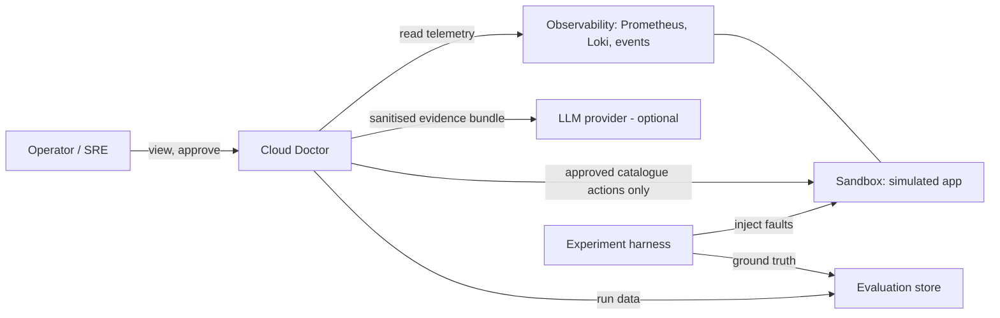
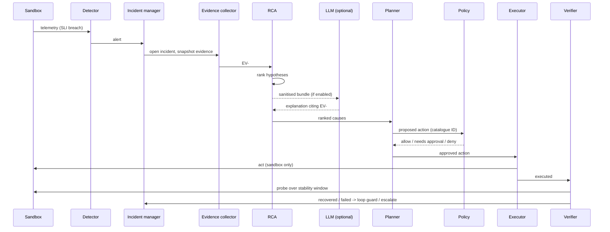

# System Architecture (Proposed, Option D)

**Status:** Design. Nothing here is implemented.

## 1. System context



## 2. Component architecture

```mermaid
flowchart TB
    subgraph UI[Frontend]
      DASH[Incident dashboard]
    end
    subgraph CORE[Deterministic core]
      API[API / authn+authz]
      DET[Detector]
      COR[Correlator + timeline]
      EVC[Evidence collector]
      RCA[Rule + topology RCA]
      PLAN[Remediation planner - catalogue]
      POL[Policy engine - default deny]
      VER[Verifier]
      RPT[Report generator]
    end
    subgraph DB[(PostgreSQL)]
      INC[(incidents, evidence, timeline)]
      AUD[(audit log)]
    end
    subgraph AI[AI zone - advisory]
      BUN[Bundle sanitiser]
      LLM[LLM adapter + validator]
    end
    subgraph EX[Execution zone]
      EXE[Executor]
    end
    SBX[(Sandbox app + telemetry)]
    DASH --> API
    SBX --> DET --> COR --> EVC --> INC
    INC --> RCA --> PLAN --> POL --> EXE --> SBX
    INC --> BUN --> LLM --> PLAN
    EXE --> VER --> RPT
    SBX --> VER
    POL --> AUD
    EXE --> AUD
```

## 3. Sequence for one incident



## 4. Answers to the final-architecture questions (PROPOSED)

| Question | Proposed answer |
|---|---|
| What detects? | SLI burn-rate and threshold rules with hysteresis (Prometheus rules / Cloud Doctor detector) |
| What gathers evidence? | Evidence collector with stored queries (EV-###) |
| What builds the timeline? | Correlator from alerts, metric changes, logs, container/deploy events, actions |
| What determines likely root cause? | Deterministic topology + signature ranking; LLM optional |
| Role of AI? | Explain, rank, recommend; never execute |
| What determines safety? | Policy engine, default deny |
| What executes / where? | Minimal executor / sandbox only |
| What determines recovery? | Verifier: readiness, dependencies, SLIs over window, synthetic transaction, no regression |
| If remediation fails? | Loop guard, cooldown, escalation |
| Infinite loops? | Max attempts, budgets, circuit breaker |
| What is audited? | Detection, diagnosis, policy decisions, approvals, actions, verification |
| AI unavailable? | Deterministic diagnosis and templated report |
| Telemetry unavailable? | Health `UNKNOWN`, no remediation from missing data, self-alert |
| RCA wrong? | Verification fails → retry bounded → escalate; contradicting evidence and alternatives reported |
| Recovery worsens system? | Regression abort, rollback where defined, escalate |

## Open items

Sandbox choice (ADR-004), policy engine (ADR-005), deployment diagram, trust-boundary diagram (see `threat-model.md`).
