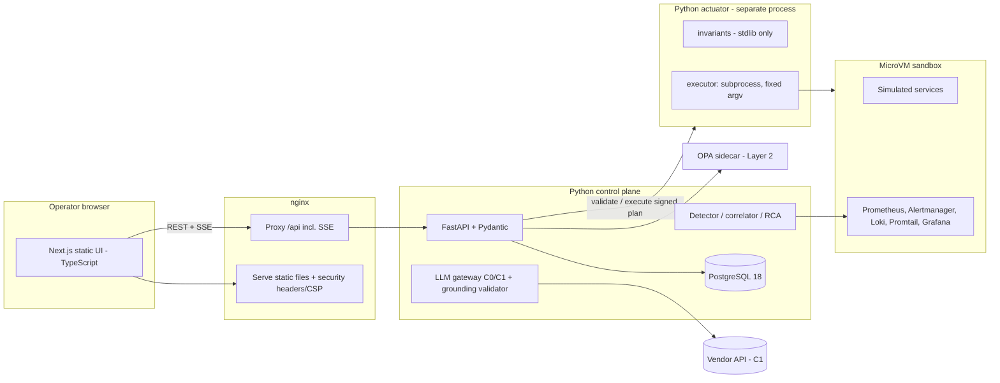

# Cloud Doctor — Final Technology Stack

**Status:** consolidated stack decision for the prototype, as of 2026-10-31. Sourced facts cite the register; everything labelled *judgment* is an engineering judgment, not evidence. **No component has been built or tested.** Statuses: **Decided** (user or accepted ADR), **Selected** (recommended here, verified against documentation), **Provisional** (depends on spikes/verification), **To choose** (not yet researched).

## 1. Result: the stack at a glance

| Layer | Choice | Status | Basis |
|---|---|---|---|
| Backend language | **Python** (a currently supported 3.x release, pinned) | Decided (ADR-007) | User decision |
| API framework | **FastAPI** (≥ 0.135.0 for built-in SSE) + **Pydantic** | Selected | S-106, S-107, S-109 |
| Frontend | **Next.js + TypeScript**, **static export** (no Node runtime) | Decided (ADR-007); static export Selected | S-101 |
| API contract | **OpenAPI + JSON Schema**, TS types via **openapi-typescript** | Selected | S-106, S-109, S-111 |
| Live updates | **Server-sent events** from FastAPI | Selected | S-107 |
| Database | **PostgreSQL 18** (JSONB, GIN) | Selected | S-117, S-119 |
| DB access / migrations | **SQLAlchemy 2.x** (async) + **Alembic** | Selected (versions pinned at setup) | S-120, S-121 |
| Metrics / alerts | **Prometheus + Alertmanager** | Decided (ADR-002) | S-004–S-007, S-060 |
| Logs | **Loki + Promtail** | Decided (ADR-002), provisional on ingestion tests | S-016, S-017, S-050, S-051 |
| Dashboards (ops) | **Grafana** (secondary to the Next.js incident UI) | Decided | ADR-002 |
| Observability config base | the user's existing observability stack configuration | Provisional (configured but unverified) | `reuse-from-existing-projects.md` |
| Tracing | OpenTelemetry — **deferred** | Decided (deferred) | ADR-002 |
| Sandbox | **MicroVM with private Docker daemon** (Docker Sandboxes; Freestyle or plain VM as alternatives), Docker Compose inside | Provisional (spikes S1–S7) | ADR-004; S-093, S-095 |
| Fault injection | Container control, **Toxiproxy**, Docker resource limits, load/stress processes | Selected | S-027–S-029 |
| Policy | **Hybrid:** Layer 1 `invariants` (Python, stdlib only) in a separate **actuator process** + Layer 2 **OPA** sidecar (REST) | Decided (ADR-005, ADR-007) | S-034, S-052, S-097–S-099 |
| LLM channels | **C0** (no LLM) and **C1** (vendor API); C2/C3/C4 designed, not built | Decided (ADR-006) | S-083–S-091 |
| Reverse proxy / static host | **nginx** (serves the static UI, proxies `/api`, sets security headers) | Provisional (Caddy not researched) | S-101, S-107 |
| Supply chain & quality | `pip` hash-checking, `pip-audit`, `mypy --strict`, Bandit, `subprocess` without a shell | Selected | S-112–S-116 |
| Test/CI tooling (pytest, UI tests, CI service) | — | To choose | not researched |

## 2. Decisions, reasons and tradeoffs

### 2.1 Frontend: Next.js as a static export
- **Facts:** `output: 'export'` makes `next build` produce an `out` folder deployable on "any web server that can serve HTML/CSS/JS static assets"; unsupported under export: cookies, headers, rewrites, redirects, proxy, Server Actions, ISR, route handlers that read the Request, default image optimisation [S-101]. Server Components run only at build time under export [S-101].
- **Why it fits:** the dashboard is a client of the Python API; static export removes a Node server from the trust boundary, and Server Actions (reachable by direct POST, per the framework's own security guide) are not used [S-104].
- **Consequences (design rules):**
  1. All data is fetched client-side from the Python API; no business logic, authorization or secrets in the UI layer.
  2. **Authentication is enforced by the Python API.** Next.js guidance: set cookies on the server, put "the majority of security checks … as close as possible to your data source," and don't rely on proxy/middleware alone [S-103]. Here the "server" is FastAPI: session cookie `HttpOnly`, `Secure`, `SameSite` set by the API.
  3. **CSP is set by nginx, not by Next.js.** Nonce-based CSP requires dynamic rendering of every page [S-102], and `headers()` configuration is unsupported under export [S-101]; so the CSP and other security headers are applied at the web server. Without nonces, the framework's documented fallback uses `'unsafe-inline'` for scripts/styles (a weaker policy) and hash-based CSP via SRI is **experimental** [S-102]. *Open item F1:* determine the strictest CSP a static export can achieve; treat CSP as defence in depth, with primary protection being escaped rendering.
  4. Evidence/log text is rendered as plain text only; no raw-HTML injection APIs for evidence (TM-16). *Judgment:* React's default escaping is relied upon, but no source on it was read.
- **Tradeoff:** no server-rendered live data and no framework-level auth gating; acceptable for a client-rendered operations dashboard.
- **Not found:** current stable Next.js version and Node.js minimum on the pages read — pin through the lockfile and verify at setup.

### 2.2 API: FastAPI + Pydantic, contract-first
- **Facts:** FastAPI is based on type hints and on OpenAPI and JSON Schema standards, with automatic docs and client generation [S-106]; Pydantic generates JSON Schema compliant with Draft 2020-12 and OpenAPI 3.1.0 (`model_json_schema`) [S-109] and offers strict (no-coercion) validation per call, field or model [S-110]; FastAPI added **built-in SSE in 0.135.0** (`EventSourceResponse`, 15-second keep-alive ping, `Cache-Control: no-cache`, `X-Accel-Buffering: no`) [S-107]; security tooling for API keys, bearer/OAuth2 and the `password` flow exists, and OAuth2 "expects you to have your application served with HTTPS" [S-108].
- **Design:** strict validation on all inputs (plans, approvals, evidence); the OpenAPI document is generated from the models and is the contract; `openapi-typescript` generates **runtime-free** TypeScript types from OpenAPI 3.0/3.1 (requires a recent Node, 20.x or higher recommended) [S-111].
- **Not verified:** minimum Python version for FastAPI; Pydantic `extra='forbid'` behaviour (not on the pages read) — verify before relying on it to reject unknown fields.

### 2.3 Database: PostgreSQL 18, JSONB for evidence
- **Facts:** `jsonb` is preferred for most applications and supports GIN indexing (`jsonb_ops`, smaller/faster `jsonb_path_ops` for containment); `json` keeps exact text but cannot be indexed that way [S-117]; **`jsonb` rejects `\u0000` and does not preserve whitespace or key order** [S-117, summary-level]. PostgreSQL supports each major for 5 years; at the time read, 18 is current (final release 2030-11-14) and 14's final release is 2026-11-12 [S-119].
- **Design consequences:**
  1. Strip or escape NUL characters from log text **before** storing evidence payloads, otherwise inserts can fail.
  2. Compute the evidence **integrity hash over a canonical serialisation before insert** and store it; do not recompute from JSONB output, which changes formatting and key order.
  3. Evidence stores query results, not raw streams (`data-architecture.md`).
- **Audit table privileges:** PostgreSQL grants privileges per operation (`INSERT`, `UPDATE`, `DELETE`, `TRUNCATE` are separate) and no privileges are granted to `PUBLIC` on tables by default [S-118]. The page gives no insert-only recipe; *inference:* the application role receives only `INSERT` and `SELECT` on the audit table, and the table is owned by a separate migration role. Row security policies were not read. Tamper-evidence still comes from the hash chain, and chain writes must be serialised (judgment).
- **ORM/migrations:** SQLAlchemy provides Core and ORM with asyncio support [S-120]; Alembic is its migration tool [S-121]. The docs show a 2.1 series as current and 2.0 as maintenance — pin exact versions at setup; the Alembic current version was ambiguous on its pages.

### 2.4 Policy and actuator (Python)
- Layer 1 `invariants` is a stdlib-only package imported by both the API and the actuator; the actuator is a separate process with its own OS user and environment (ADR-007).
- Executor: build argument vectors from validated parameters and call `subprocess` with an argument **sequence** (the standard library documents that a sequence lets the module handle escaping and quoting, and that `shell=True` makes quoting the application's responsibility) [S-113]. Rule: shell never used.
- Layer 2: OPA REST sidecar; callers must treat HTTP 200 **without** a `result` key as undefined → deny; sign bundles with an explicit `signing` block; check bundle health [S-098, S-099].

### 2.5 Supply chain and code quality gates
- **Hash-checked installs:** pip's hash-checking mode is all-or-nothing — once any requirement has `--hash`, hashes are required for *all* requirements including dependencies, and requirements must be pinned (`==`); `--require-hashes` forces it [S-112]. The page shows no hash-generation command; choose and verify a lock-file generator during setup.
- **`pip-audit`** scans dependencies for known vulnerabilities (PyPA advisory database via PyPI/OSV), is not a static code analyser, and should be run on inputs you would be willing to install [S-116].
- **Bandit** builds an AST per file and runs plugins to find common security issues [S-115]; its limitations were not stated on the overview page — treat it as one signal.
- **`mypy --strict`** enables a defined subset of optional checks; the exact flag list may change between versions [S-114].
- CI gates (to implement): locked + hashed dependencies, `pip-audit`, strict typing, Bandit, contract tests, policy tests, injection corpus, `promtool`/`amtool` config checks.

### 2.6 Observability and sandbox (carried from earlier ADRs)
Prometheus + Alertmanager (grouping, inhibition, webhook receiver; idempotent consumer), Loki + Promtail (low-cardinality labels, structured metadata), Grafana for operator views; configuration base from the user's existing stack, run inside the MicroVM. **The image tags pinned in that configuration date from earlier releases; check current versions and security advisories before reuse** (not verified here).

### 2.7 LLM
C0 and C1 only (ADR-006). Candidate C1 models for the evaluation arms: a lower-cost tier and a mid tier from the price list read [S-083]; avoid model classes that require 30-day retention unless the client accepts it [S-086]. Accuracy by model is a hypothesis, to be measured.

## 3. Tradeoffs accepted
- Python actuator has a larger footprint than a compiled binary → mitigated by process isolation, stdlib-only invariants, restricted user, MicroVM boundary.
- Static-export UI cannot use framework auth/CSP features → compensated by API-side auth and nginx headers.
- Reuse of the observability configuration saves effort but inherits unverified status and dated pins.
- Several tools are proprietary or vendor-dependent (Docker Sandboxes sign-in, LLM vendor); the Compose stack stays portable as a fallback.

## 4. Not decided / not verified
Test and CI tooling; nginx hardening specifics (Caddy not researched); exact Python, Next.js, Node, FastAPI, SQLAlchemy and Alembic versions; Pydantic `extra='forbid'`; lock-file generator; achievable static-export CSP (F1); row-level security for audit tables; Docker Sandboxes spikes S1–S7; OPA health/bundle endpoint details; Alertmanager webhook retry behavior on the pinned version.

## 5. What this stack does *not* change
No code exists, no experiment has run, and no result is claimed. The stack choices affect build effort and the attack surface, not whether the AI layer improves diagnosis (hypothesis H-AI-1 remains untested).

## References
S-083, S-086, S-093, S-095, S-098, S-099, S-101–S-121 and ADR-001…007 in `docs/13-decisions/`.
