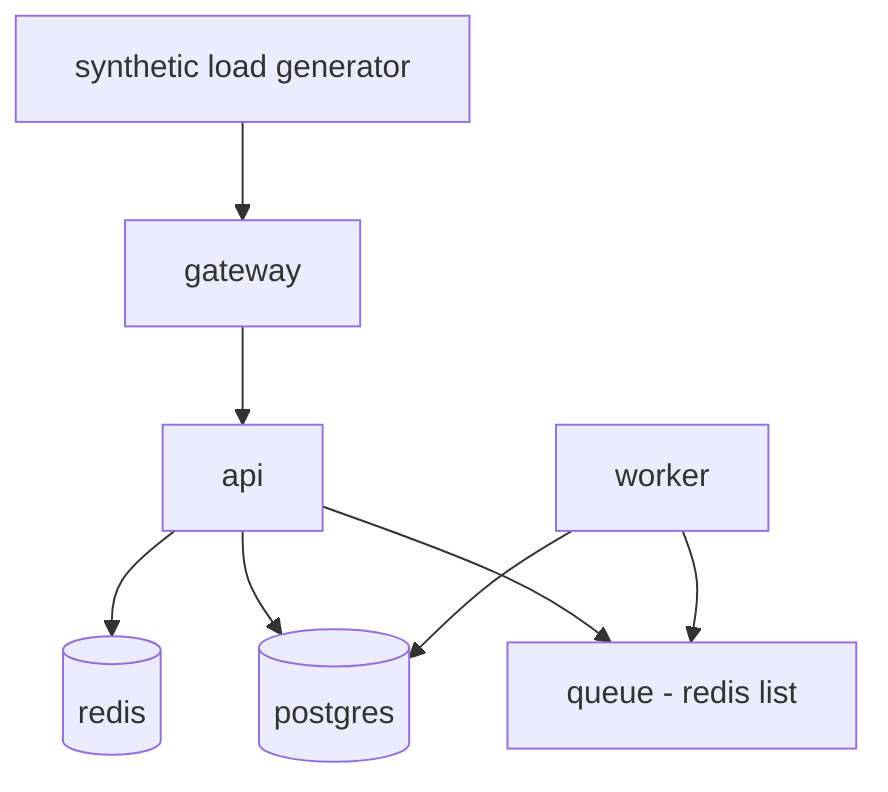

# Experiment Framework

**Status:** Design only. **No experiment has been executed. No results exist.** Everything labelled "expected" is a HYPOTHESIS written before running, so it can be falsified.

## Principles

Based on chaos-engineering practice [S-027]: define a measurable steady state, introduce a real-world-type fault, and try to disprove that steady state holds; keep blast radius small. Departure: sandbox only.

## Reference topology (ASSUMPTION, subject to ADR-004)

The `queue` shares Redis with the cache in this sketch, which deliberately creates ambiguity (Redis outage affects both API and worker). Whether to keep that is an OPEN QUESTION.

## Run protocol

1. Start the stack at pinned image versions; run synthetic load; wait for steady state (SLIs within baseline for T_baseline).
2. Record baseline snapshot.
3. Control run: no fault, same duration → count false incidents.
4. Experimental run: inject fault at `t_inject` (logged by the harness as ground truth).
5. Cloud Doctor runs the full pipeline; the harness records `t_impact`, `t_detect`, `t_diagnose`, `t_action`, `t_recover`.
6. Abort conditions: blast-radius cap exceeded, duration cap, or harness error. Aborts are reported, not hidden.
7. Teardown and reset to a clean state.
8. Repeat N times (N set after observing variance) with variants: LLM on/off; injected-log noise on/off.

## Run metadata (stored per run)

Git commit, image digests, configuration, scenario ID, seed, model ID and parameters, prompts hash, start/end times, host spec.

## Scenario catalogue

| ID | Scenario | Ground-truth cause | Special purpose |
|---|---|---|---|
| EXP-01 | Redis outage | redis down | Cascade symptom vs. cause |
| EXP-02 | Worker crash | worker process exit | Simple restart-safe |
| EXP-03 | CPU saturation | CPU hog in api | Resource saturation; gradual onset |
| EXP-04 | Memory exhaustion | leak in api → OOM | Gradual; restart is temporary |
| EXP-05 | DB connection exhaustion | connection leak | Restart may not fix |
| EXP-06 | Network latency | Toxiproxy latency on DB link | Latency without errors |
| EXP-07 | Bad deployment | faulty api version | Rollback is the right action |
| EXP-08 | Dependency outage | downstream service down | Multi-hop |
| EXP-09 | False correlation | unrelated event near the symptom | Precision of RCA |
| EXP-10 | Failed remediation | fault persists after restart | Loop guard, escalation |

**Candidate additions from prior project documentation** (see `docs/00-overview/prior-work-and-lessons.md`; *proposed, not yet designed in detail and not counted among the ten*):

| ID | Scenario | Ground-truth cause | Special purpose |
|---|---|---|---|
| EXP-11 | Disk full (e.g., log or data volume filling) | filesystem exhaustion | Restart does not help; correct output may be escalation or a catalogued cleanup; tests resource-saturation rules (`DiskFilling`-style) |
| EXP-12 | Telemetry pipeline outage (Prometheus and/or Loki unavailable while services run) | collection failure, not service failure | Tests `UNKNOWN` handling, no remediation from missing data, and the three missing-signal states (expected / unexpected / collection failed) |

Related negative test (not a fault scenario): high-cardinality label injection must be rejected or normalised by the pipeline [S-051, S-006].

Each scenario file follows the template: Objective, Hypothesis, Initial State, Fault Injection, Expected Telemetry, Detection, RCA, Remediation, Verification, Metrics, Results (**pending**), Analysis, Failure Cases, Conclusion.

## Threats to validity

- Scenarios and rules authored by the same person (circular evaluation). Mitigation: hold out scenarios the rules were not written for; compare against the no-LLM baseline.
- Synthetic faults are cleaner than real ones; synthetic benchmarks may not predict real-system performance (cf. S-021).
- Small N: report distributions, not single numbers.

## References

S-021, S-027 in `docs/_sources/register.md`.
