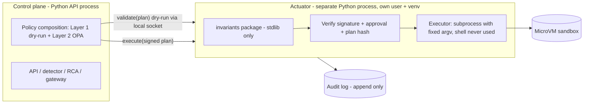

# ADR-007: Implementation Languages — Python Backend, Next.js (TypeScript) Frontend

## Status
**Accepted (user decision, 2026-10-31):** Python for the backend and all trust-critical components; Next.js with TypeScript for the dashboard. Go is **excluded** from the project. Consequences that need verification are listed below; they do not reopen the decision.

## Context
- The backend was provisionally Python/FastAPI; the evaluation work (experiments, statistics, reports) suits Python (engineering judgment; no benchmark was run).
- The most privileged component is the executor, which holds the control channel into the sandbox (TM-04). It must remain a small, separate, tightly constrained component regardless of language.
- OPA integration from Python is via the REST API (sidecar); Python Wasm SDKs found in search are community-maintained and one appeared stale [S-052, S-100]. The Layer 2 design already uses the REST sidecar (ADR-005), so this decision does not change it.
- Official vendor SDK methods exist for Python in the token-counting examples [S-084].
- The API is contract-first (`api-architecture.md`), so the UI is decoupled from the backend.

## Problem
How is the language choice used to keep the safety-critical parts small and separable now that a single backend language is used?

## Options considered
- **A — Python backend + Next.js/TypeScript UI.** *Chosen.* Two languages in total; fastest iteration; evaluation harness and product share one language.
- **B/C/D — any use of Go (hybrid, Go-only, Go + Next.js).** Considered earlier in this ADR's history and **discarded by the user's decision**; not pursued.

## Decision
- **Backend (Python):** API (FastAPI-style), incident manager, detector/correlator, evidence collector, deterministic RCA and optional probabilistic ranker, grounding validator, LLM gateway (channels C0/C1), experiment harness, evaluation and report generation.
- **Frontend (TypeScript, Next.js):** the operator dashboard only. All business logic, approvals and authorization stay in the Python API.
- **Trust-critical split inside Python:** the **actuator** is a separate Python process (own OS user, own virtual environment or container, local-only socket), not a library inside the API process. It contains Layer 1 of the policy engine and the executor.

## Python actuator design (DESIGN DECISION)



Controls:
1. **Minimal trusted computing base:** the `invariants` (Layer 1) package depends on the standard library only, so both the control plane and the actuator can import the *same* code without sharing third-party dependencies; the actuator's other dependencies are limited to a signature-verification library and a small HTTP/socket layer.
2. **Fixed command execution:** actions map to argument vectors built from validated, typed parameters; no shell, no string concatenation of commands, no dynamic evaluation, no deserialization formats that can execute code.
3. **Two enforcement points, one implementation:** decision-time dry run in the control plane, execution-time re-check in the actuator; plans are signed and bound to a plan hash; the actuator refuses on any error.
4. **Process isolation:** separate OS user and environment; socket not reachable from the AI/LLM zone; the LLM gateway key lives only in the gateway.
5. **Supply chain:** hash-pinned, locked dependencies for both processes (verify the installer's capability against its documentation before relying on it), dependency scanning in CI, minimal imports in the actuator.
6. **Static analysis and typing:** strict type checking and a security linter in CI (tools to be selected and verified).

Honest tradeoff: a Python process has a larger runtime footprint and attack surface than a small compiled binary. The mitigations are process isolation, a stdlib-only invariants package, a restricted OS user, and the MicroVM boundary around the workloads the actuator controls; the residual risk stays in the threat model (TM-04).

## Update 2026-10-31 — verification results
The framework documentation has now been read (S-101–S-111; see `docs/10-architecture/tech-stack.md`). **Confirmed:** a static export needs no Node server and is deployable on any static web host; Server Actions, cookies, headers, rewrites, redirects and Request-reading route handlers are unsupported under export; nonce-based CSP needs dynamic rendering, so under export the CSP is set by the web server; authentication checks belong near the data source; FastAPI provides built-in SSE from 0.135.0 and OpenAPI/JSON Schema generation; Pydantic supports strict validation and JSON Schema 2020-12/OpenAPI 3.1; pip hash-checking is all-or-nothing and requires pinned requirements; the standard library recommends argument sequences for `subprocess`. **Still unverified:** minimum Python/Node versions, Pydantic `extra='forbid'`, achievable CSP for a static export, hash-generation tooling, and live-update behaviour behind the chosen reverse proxy.

## Frontend design constraints (original list, now partly verified — see update above)
- UI only; no business logic, approvals or authorization in Next.js server code or route handlers.
- Prefer a **static export** (no Node runtime) if the dashboard allows it; otherwise treat any Node server as a trusted-zone component with its own hardening.
- Evidence and logs are untrusted: render as escaped text only, never as HTML; set a strict content security policy (TM-16).
- Typed API client generated from the OpenAPI contract; contract tests in CI.
- Live updates (incident timeline, health) via server-sent events or WebSocket from the Python API — to verify.
- Authentication: enforced by the API (session or token), with plan-hash-bound approvals (`policy-engine.md`).

## Repository layout (proposed)

```text
backend/      # Python: api, detect, rca, evidence, gateway, validator, harness, report
actuator/     # Python: separate process (invariants imported from backend/invariants)
frontend/     # Next.js + TypeScript
contracts/    # OpenAPI + JSON Schema (plan, decision, evidence, diagnosis, report)
tests/        # unit, contract, policy, injection corpus, experiment configs
```

## Consequences
- Policy Layer 1 lives in the Python `invariants` package and is enforced in the separate actuator process (`policy-engine.md` updated).
- The reuse analysis now means **porting the design** of the existing prototypes' evidence collection and LLM client to Python, with the fixes identified there (evidence records, failure states, sanitisation); no code reuse across languages.
- CI covers Python and TypeScript only.
- Roadmap: Phase 9–10 build the actuator process; Phase 12 builds the Next.js dashboard.

## Reconsideration Conditions
Reopen only if a concrete problem is found that cannot be mitigated (for example, process isolation proves insufficient in security testing of the actuator, or evaluation throughput is a measured bottleneck).

## References
S-052, S-084, S-100; `docs/06-self-healing/policy-engine.md`; `docs/09-security/threat-model.md`; `docs/10-architecture/api-architecture.md`.
