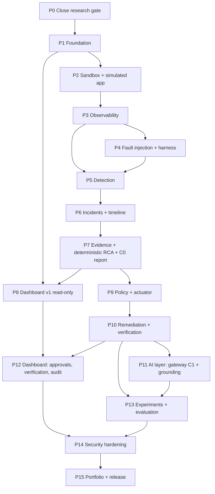

# Development Plan (assuming Phase 0 research is closed)

> **Timeline override:** the project has a hard deadline — build 31 Oct–4 Nov, MVP testing on 5 Nov 2026. The schedule for that window (full scope retained at the user's instruction, with the capacity arithmetic, parallel streams and daily gates) is in `mvp-plan-5-nov.md`. The effort estimates in this document remain planning figures and are **4–8× larger than the available window**; see that plan's section 1.

**Status:** plan only. Nothing here is built, and no effort figure is a measurement. Effort ranges are **planning assumptions** (one developer, about 14 hours per week, no parallel work, no productivity multiplier from tooling) and should be re-estimated after the first two phases. The plan implements the stack in `docs/10-architecture/tech-stack.md` and the accepted decisions in `docs/13-decisions/`. It refines the earlier 16-phase list in `implementation-recommendations.md`.

## 1. What changes relative to the earlier roadmap

| Change | Reason |
|---|---|
| Add **Phase 1 Foundation** (repo, CI, contracts, schema, supply-chain gates) before the sandbox | Contract-first API (ADR-007), audit/evidence tables and quality gates are needed by every later phase |
| Move **AI integration after remediation and verification** (old Phase 8 → new Phase 11) | The deterministic core must work end to end first (FR-006, ADR-001); AI value is then measured against a working baseline (H-AI-1) |
| Build the **dashboard incrementally**: read-only v1 early (Phase 8), approvals/verification/audit later (Phase 12) | Operators need to see incidents as soon as detection works; avoids a late UI big bang |
| Merge old Phases 6 and 7 slices into a **read-only end-to-end milestone** (M2) | A demonstrable "detect → diagnose → report" loop before any action is possible reduces risk |
| Add an explicit **Phase 0 gate** that closes the open research items | ADR-004/005/002 depend on spikes and verification that are not done |

Mapping: old 1 Sandbox → P2; 2 Service simulation → P2; 3 Observability → P3; 4 Failure injection → P4; 5 Detection → P5; 6 Correlation → P6; 7 RCA → P7; 8 AI → P11; 9 Policy → P9; 10 Remediation → P10; 11 Verification → P10; 12 Dashboard → P8 + P12; 13 Security → P14; 14 Evaluation → P13; 15 Portfolio → P15.

## 2. Phases at a glance



Milestones:

| ID | After | Demonstrable outcome |
|---|---|---|
| **M0** | P0 | ADRs accepted; spikes passed or fallback chosen |
| **M1** | P4 | An observable sandbox where any of the injected faults can be triggered reproducibly with ground truth recorded |
| **M2** | P8 | **Read-only loop:** fault injected → incident opened → timeline and evidence → ranked root cause → deterministic report, visible in the dashboard (challenge deliverables 1–3 without recovery) |
| **M3** | P10 | **Closed loop without AI:** policy-checked, sandbox-only remediation with verified recovery, failed-recovery handling and loop prevention (challenge deliverable 4) |
| **M4** | P11–P12 | AI explanation grounded in evidence with C0 fallback; approvals and audit in the UI |
| **M5** | P15 | Experiments run, metrics computed, security review done, documentation updated with results (release v0.1) |

## 3. Scope tiers (what to cut if behind)

| Tier | Phases | Covers | Effort (low–high hours) |
|---|---|---|---|
| **Tier 1 — challenge MVP** (C0 only, 4 core scenarios: Redis outage, worker crash, memory exhaustion, bad deployment) | P0–P10 | Dashboard (read-only), detection, timeline, evidence-backed RCA, sandbox remediation with verification and loop guards | 340–620 |
| **Tier 2 — full research system** | + P11–P13 | AI channel C1 with grounding, remaining scenarios, evaluation | 450–820 |
| **Tier 3 — release quality** | + P14–P15 | Security hardening, results documentation, demo | 490–900 |

At about 14 hours a week the full range is roughly 35–64 weeks and Tier 1 alone roughly 24–44 weeks (planning arithmetic, not a forecast). Scope levers, in order of least harm: reduce scenarios per tier; skip P12 extras (audit views) until P13 needs them; defer scenarios EXP-11/12; replace the micro-VM with a plain dedicated VM if spikes fail.

## 4. Repository layout (from ADR-007)

```text
backend/        # Python: api, detect, incidents, evidence, rca, gateway, validator, harness, report
actuator/       # Python: separate process; imports backend/invariants (stdlib only)
frontend/       # Next.js + TypeScript (static export)
contracts/      # OpenAPI + JSON Schema (plan, decision, evidence, diagnosis, report)
infra/          # Compose files, service catalog, observability config, nginx, sandbox scripts
experiments/    # scenario configs, ground truth, run metadata schema
tests/          # unit, property, contract, policy, injection corpus, integration
docs/           # existing research documentation
```

## 5. Working agreements

- Conventional commits, one logical change each, **no attribution or co-author lines**; docs updated in the same change as code where behavior changes.
- Every phase ends with: ADR/limitations updated, acceptance tests green in CI, a short demo script, and "result pending" replaced by a result **only** when an experiment has actually run.
- Never claim a metric before it is measured; unmeasured stays "pending".
- CI gates from Phase 1: locked and hash-checked dependencies, dependency audit, strict typing, security lint, unit and contract tests; later phases add policy tests, injection corpus, `promtool`/`amtool` checks and integration runs.
- Phase 0 spikes and any vendor assumptions are recorded in the ADRs with pass/fail.

## 6. Phase details

Format: **Objective · Prerequisites · Work items · Deliverables · Tests · Acceptance criteria · Risks · Effort.**

### P0 — Close the research gate
- **Objective:** turn the proposed ADRs into accepted decisions.
- **Work:** run spikes S1–S7 (sandbox control, host-to-VM observation, limits, observability stack in the VM including `/dev/kmsg` and host networking, no host mounts, egress policy, CI feasibility); verify OPA health/bundle endpoints and Rego test workflow; test Alertmanager webhook retry on the pinned version; determine achievable CSP for a static export (F1); read the remaining papers; verify current versions and advisories for pinned images and dependencies.
- **Deliverables:** spike report, ADR-002/004/005 accepted or revised, updated `limitations.md`, pinned version list.
- **Tests:** each spike has a pass/fail checklist (✅/🚫/❌).
- **Acceptance:** no open blocker in `quality-gate-review.md`; fallback chosen where a spike fails.
- **Risks:** micro-VM tooling unfit (fallback: same Compose stack in a dedicated VM); CI cannot run KVM (run integration locally).
- **Effort:** 20–40 h.

### P1 — Foundation
- **Objective:** a repository that enforces quality from the first commit.
- **Work:** scaffold layout; lockfiles with hashes; CI pipeline; strict typing and security lint; `invariants` package skeleton (stdlib only); OpenAPI/JSON Schema skeleton and typed client generation; PostgreSQL 18 schema and migrations for services, alerts, incidents, evidence, timeline, hypotheses, plans, decisions, executions, verification, audit (insert-only grants, hash chain design, canonical-JSON hashing, NUL-character sanitising); configuration and secrets handling.
- **Deliverables:** green CI, migration set, contract skeleton, developer setup guide.
- **Tests:** migration up/down; audit table cannot be updated or deleted by the app role; canonical hash stable; contract-generation round trip.
- **Acceptance:** FR-017 groundwork; supply-chain gates enforced in CI.
- **Risks:** tooling choices unresolved (hash generator, test framework) — decide here.
- **Effort:** 20–40 h.

### P2 — Sandbox and simulated application
- **Objective:** an isolated environment running a small multi-service app.
- **Work:** micro-VM (or fallback VM) bring-up and teardown scripts; clone/mountless workspace; deny-by-default egress; service catalog ("topology as code") from which scrape targets, dependency graph, health probes and the expected-state registry are generated; services: gateway, API, Redis, worker, PostgreSQL, load generator; structured JSON logs with request IDs; `/metrics`; health endpoints (readiness separate from liveness); synthetic transaction endpoint.
- **Deliverables:** reproducible sandbox, catalog, steady-state baseline recorded.
- **Tests:** control run stays steady; no host mounts beyond the clone; egress blocked as configured; reset produces a clean state.
- **Acceptance:** M1 prerequisite; FR-016 groundwork; NFR-006 (reproducible).
- **Risks:** realism of the simulated app; load generator below the traffic needed for burn-rate rules (keep well above 1 request per second).
- **Effort:** 40–80 h.

### P3 — Observability
- **Objective:** metrics, logs and alert delivery working end to end inside the sandbox.
- **Work:** adopt the existing configuration as a base (verify it first, update pinned versions, remove credential fallbacks); scrape config generated from the catalog; Loki labels (low cardinality) and structured metadata for IDs; Alertmanager with webhook receiver to the API; shortened timers; idempotent webhook handler; `promtool`/`amtool` checks in CI; Grafana operator dashboards.
- **Deliverables:** observability stack as code, verification checklist.
- **Tests:** real-fault pipeline test (stop a container → pending → firing → resolved → webhook received); synthetic alert for webhook plumbing only; duplicate webhook delivery handled once; label-cardinality guard test.
- **Acceptance:** FR-002; telemetry-gap detection (`absent`) works.
- **Risks:** `network_mode: host`, `/dev/kmsg` and data-root differences inside the VM; Loki ordering behavior.
- **Effort:** 25–45 h.

### P4 — Fault injection and experiment harness
- **Objective:** reproducible faults with recorded ground truth.
- **Work:** injector in its own trust zone (separate credentials, not reachable from the control plane); scenarios for the four Tier-1 faults first (stop/kill, memory leak under limit, bad image version, queue backlog), then Toxiproxy latency, CPU, DB connections; scenario config schema; run protocol (baseline, control, injection, abort, teardown); run metadata store; ground-truth timestamps.
- **Deliverables:** harness CLI, scenario configs, run metadata.
- **Tests:** each scenario reproducible across runs; abort works; control runs produce no incident (after P5).
- **Acceptance:** FR-016; M1.
- **Risks:** injector exposure; resource-limit behavior inside the VM.
- **Effort:** 25–45 h.

### P5 — Detection
- **Objective:** deterministic, explainable failure detection.
- **Work:** SLI computation; multiwindow multi-burn-rate rules scaled for the simulation; threshold, trend (`deriv`/`predict_linear`) and absence rules with hysteresis; log error-burst signal; expected-state registry; three missing-signal states; replace threshold-style SLO rules.
- **Deliverables:** rule set as code, detector configuration, detection tests.
- **Tests:** per-scenario detection within the deadline; control runs yield zero incidents; flapping test; low-traffic test; detection scored per injected incident, never point-adjusted.
- **Acceptance:** FR-001; NFR-004.
- **Risks:** window scaling unvalidated; baseline contamination (validate by control run).
- **Effort:** 30–50 h.

### P6 — Incidents and timeline
- **Objective:** one incident per fault with a trustworthy timeline.
- **Work:** alert grouping by connected component in the dependency graph plus time window; incident state machine; timeline builder (alerts, metric changes, logs, container and deploy events, actions); event versus collection time; duplicate handling; merge/split rules; suppressed alerts retained as evidence.
- **Deliverables:** incident manager, timeline API.
- **Tests:** cascade (cache down → worker errors → API errors) yields one incident; unrelated concurrent fault yields a second; out-of-order events ordered correctly.
- **Acceptance:** FR-003.
- **Risks:** time-window tuning; mega-incidents.
- **Effort:** 20–40 h.

### P7 — Evidence and deterministic RCA (C0)
- **Objective:** ranked, evidence-backed root cause without any LLM.
- **Work:** evidence collector with queries recorded and statuses (`ok`, `empty`, `error`, `timeout`); evidence store with provenance and hashes; candidate generation from topology, change events and fault signatures; scoring with supporting and contradicting evidence, alternatives and unknowns; optional probabilistic ranker behind the same interface; deterministic report (JSON and rendered).
- **Deliverables:** RCA engine, report generator, evidence API.
- **Tests:** correct top cause on each Tier-1 scenario; decoy event (false correlation) not ranked first; failed queries appear as unavailable, never as "no data"; evidence coverage 100% of report claims.
- **Acceptance:** FR-004, FR-005, FR-006 (report works with no LLM), FR-014.
- **Risks:** circular evaluation (rules written by the same author as scenarios) — hold out scenarios.
- **Effort:** 40–70 h.

### P8 — Dashboard v1 (read-only)
- **Objective:** the operator view for challenge deliverable 1 and the RCA view.
- **Work:** Next.js static export served by nginx with security headers; typed client from the contract; login against the API (server-set cookie); views: service health with `UNKNOWN`, active incidents, timeline, metrics, logs, dependency graph, evidence, RCA and report; SSE for live updates; evidence rendered as escaped text only.
- **Deliverables:** frontend, nginx config, UI tests.
- **Tests:** untrusted-log injection renders inert; unauthenticated access denied by the API; SSE reconnect; contract tests.
- **Acceptance:** FR-015 (read-only parts); **M2 demo**.
- **Risks:** achievable CSP for a static export; UI scope creep.
- **Effort:** 35–65 h.

### P9 — Policy and actuator
- **Objective:** make unauthorized execution structurally impossible.
- **Work:** `invariants` (catalogue, typed bounds, sandbox allowlist, risk ceiling, budgets, evidence precondition, parameter-derivation rule, dependency-aware rule); separate actuator process (own user, local socket, signature and plan-hash verification, fixed argument vectors, no shell); OPA sidecar with signed bundles and fail-closed handling (undefined result → deny); decision records; approvals bound to plan hash; append-only audit log with hash chain.
- **Deliverables:** actuator, policy layers, audit.
- **Tests:** adversarial proposals (unknown action, oversized parameters, non-sandbox target, parameter smuggling); both layers' composition matrix; OPA down, `{}`, stale bundle → deny; replayed and forged approvals; audit write failure → deny.
- **Acceptance:** FR-009, FR-011, FR-017; NFR-001, NFR-002; zero unauthorized actions in the suite.
- **Risks:** Rego test workflow unverified; control-channel design into the VM.
- **Effort:** 40–70 h.

### P10 — Remediation and verification
- **Objective:** closed-loop recovery in the sandbox, proven by verification.
- **Work:** action catalogue (restart, rollback, scale where supported, clear cache, escalate); planner mapping causes to actions with selection rules; remediation state machine, attempts, cooldown, circuit breaker, regression abort; verifier (readiness, dependencies, SLIs over the stability window, independent synthetic probes, no-regression check, relapse window); evidence snapshot before any action; recovery report.
- **Deliverables:** remediation engine, verifier, reports.
- **Tests:** each Tier-1 scenario recovers and is verified; running-but-unhealthy ≠ recovered; persistent fault (EXP-10) ends in escalation without exceeding the attempt limit; regression triggers rollback/escalation; restart-loop test; policy-down test executes nothing.
- **Acceptance:** FR-008, FR-010, FR-012, FR-013; **M3 demo**.
- **Risks:** stability-window tuning; actions unsupported by the sandbox (scale).
- **Effort:** 45–75 h.

### P11 — AI layer (channels C0/C1)
- **Objective:** optional AI explanation that cannot affect safety.
- **Work:** LLM gateway with one interface and capability flags; sanitiser, redaction and bundle builder; structured output with evidence IDs; five-stage grounding validator; bounded read-only evidence tools; token and call budgets, token counting before calls; audit fields (channel, model, tokens, latency); deterministic fallback on any failure.
- **Deliverables:** gateway, validator, injection corpus.
- **Tests:** seeded-error set measures the validator's own detection; poisoned logs never change decisions; LLM unavailable → C0 report unchanged; budget exhaustion → hard stop to C0; secrets not present in bundles.
- **Acceptance:** FR-007; NFR-003, NFR-010; **M4 (with P12)**.
- **Risks:** vendor model terms (retention classes); nondeterminism (pin model IDs and parameters).
- **Effort:** 40–70 h.

### P12 — Dashboard completion
- **Objective:** operator actions and accountability in the UI.
- **Work:** remediation plans, policy decisions and approvals (plan-hash binding), verification view with before/after comparison, audit history, self-health panel and degraded-mode banner.
- **Tests:** approval flow end to end; expired and tampered approvals refused; UI cannot bypass API authorization.
- **Acceptance:** FR-011, FR-015 complete; NFR-008.
- **Effort:** 20–40 h.

### P13 — Experiments and evaluation
- **Objective:** produce measured results, honestly reported.
- **Work:** run the ten scenarios (plus EXP-11/12 if in scope) with repetitions, control runs and variants (LLM off/on, injected-log noise); compute detection, diagnosis, recovery, safety and AI metrics with ranges and sample sizes; trivial baselines for every comparison; per-scenario recoverability check that ground truth is visible in the telemetry; results documents; replace "pending" only for measured items.
- **Deliverables:** results documents, run archive, evaluation scripts.
- **Tests:** reproducibility on a second machine; seeded-error validator test.
- **Acceptance:** FR-018; NFR-006; every reported number traceable to runs.
- **Risks:** small N, synthetic cleanliness, circular evaluation — state all as limitations.
- **Effort:** 50–90 h.

### P14 — Security hardening
- **Objective:** verify the threat model rather than assume it.
- **Work:** negative tests for each threat (TM-01…TM-16); dependency audit and update cycle; secrets review; CSP verification; network-policy tests for sandbox egress; actuator and policy bypass attempts; backup/restore and reset drills (proven by restore, not by archive existence); `✅/🚫/❌` security checklist.
- **Acceptance:** zero unauthorized actions in the full suite; documented residual risks.
- **Effort:** 25–45 h.

### P15 — Portfolio and release
- **Objective:** defensible, reproducible release v0.1.
- **Work:** update README and final architecture with measured results and limitations; demo script and recording plan; reproduction guide; ADR status review; release notes with explicit non-claims.
- **Acceptance:** another engineer can reproduce the demo and results from the documentation.
- **Effort:** 15–35 h.

## 7. Requirement traceability

| Requirement | Phase(s) |
|---|---|
| FR-001 detect | P5 |
| FR-002 collect telemetry | P3, P7 |
| FR-003 timeline | P6 |
| FR-004 evidence records | P7 |
| FR-005 hypotheses | P7 |
| FR-006 works without LLM | P7, P10 (verified again in P11) |
| FR-007 grounded LLM explanation | P11 |
| FR-008 recommend remediation | P10 |
| FR-009 policy evaluation | P9 |
| FR-010 sandbox-only execution | P9, P10 |
| FR-011 approvals | P9, P12 |
| FR-012 verify recovery | P10 |
| FR-013 loop bounds | P10 |
| FR-014 reports | P7, P10, P11 |
| FR-015 dashboard | P8, P12 |
| FR-016 fault injection | P4 |
| FR-017 audit | P1, P9 |
| FR-018 evaluation harness | P4, P13 |
| NFR-001 fail closed | P9, P10, P14 |
| NFR-002/003 isolation, untrusted telemetry | P9, P11, P14 |
| NFR-004 missing telemetry | P5 |
| NFR-006 reproducibility | P2, P4, P13 |

## 8. Definition-of-done checklist mapped to phases

| Item | Phase |
|---|---|
| Service dashboard, metrics, logs | P3, P8 |
| Failure injection works | P4 |
| Failure detected, incident created, timeline | P5, P6 |
| Evidence, ranked cause | P7 |
| AI explanation with evidence references | P11 |
| Remediation proposed, policy evaluated | P9, P10 |
| Sandbox execution performed, recovery verified | P10 |
| Failed recovery handled, loop prevented | P10 |
| Audit trail, recovery report | P9, P10 |
| Experiments executed, metrics calculated | P13 |
| Security review completed | P14 |
| Architecture documented | P15 (continuously updated) |

## 9. Go/no-go gates

| After | Question | If no |
|---|---|---|
| P0 | Do the spikes show the micro-VM sandbox is controllable and observable from the host? | Use a plain dedicated VM with the same Compose stack; update ADR-004 |
| P3 | Does a real fault traverse rules → Alertmanager → webhook reliably? | Fix pipeline before building detection on it |
| M2 (P8) | Does the read-only loop identify the cause on Tier-1 scenarios without hand-tuning per run? | Revisit rules and scenario design before adding actions |
| P9 | Do all bypass attempts fail? | Do not start P10 until they do |
| M3 (P10) | Does recovery verification catch the running-but-unhealthy case and the persistent-fault case? | Fix the verifier before adding AI |
| P11 | Does the LLM add measured value over the deterministic baseline? | Keep C0 as default; document the negative result |

## 10. Development risks

| Risk | Impact | Mitigation |
|---|---|---|
| Scope too large for one developer | Delay | Tier cuts; scenario reduction; P12 extras deferrable |
| Micro-VM tooling issues | Sandbox rework | Fallback VM decided at P0 |
| Unverified assumptions (versions, Pydantic strictness, CSP) | Rework | Resolved in P0/P1; recorded in ADRs |
| Circular evaluation | Overstated results | Hold-out scenarios, trivial baselines, recoverability check |
| Vendor/model drift | Irreproducible AI results | Pin model IDs, parameters, prompts; record in run metadata |
| Dependency vulnerabilities | Supply-chain exposure | Hash-pinned installs, audit in CI, minimal actuator imports |
| Over-claiming | Credibility | Results only from executed experiments; limitations kept current |

## 11. First two weeks (suggested)

1. Spike runbook (S1–S7) and execution on a KVM-capable Linux machine; record ✅/🚫/❌.
2. Verify the existing observability configuration: bring it up locally, run its alert-verification steps, note version and advisory updates.
3. Resolve open tooling choices (test framework, hash-lock generator, CI service) and record them.
4. Draft the OpenAPI contract skeleton and the database migrations; decide the Python version.
5. Update ADR-002/004/005 with outcomes; re-run the quality-gate review.

## 12. Assumptions and open items

- Effort ranges are rough planning figures, not derived from data.
- CI service and test tooling are not yet chosen.
- Nested virtualization or KVM availability in CI is unknown (spike S7).
- The development environment must support the chosen micro-VM runtime.
