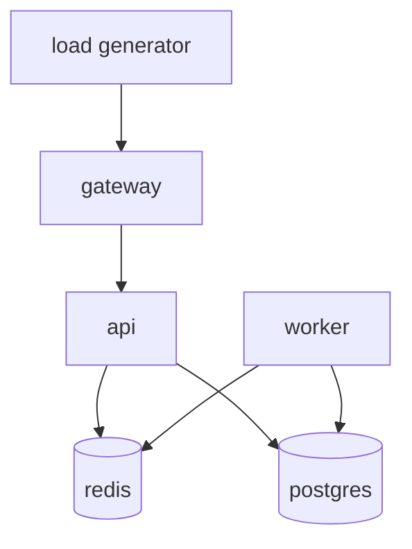
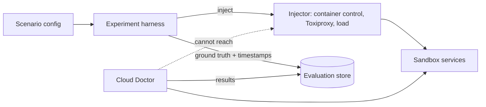
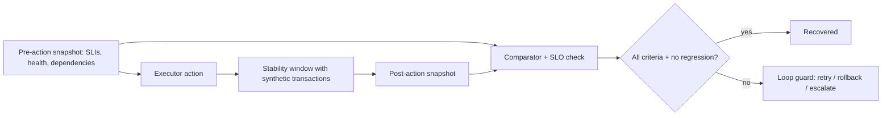

# Cloud Doctor — Final Architecture (DRAFT v0.1)

**Status:** Draft synthesis of the current research state. ADR-001…005 are *Proposed*; remaining gaps are listed in `limitations.md`. This document will be finalised only after those gaps close. **Nothing described here is implemented; no experiment has been run.**

## 1. Problem

Detect failures in a simulated cloud application, identify likely root causes from logs and metrics, recommend recovery, execute it only in an isolated sandbox, and prove recovery. See `docs/00-overview/00-research-plan.md`.

## 2. Research findings

Summarised in `findings.md` (F-01…F-20). Principal conclusions: symptom-based SLO detection with supporting resource signals; no single RCA method generalises (S-021); LLM RCA is promising but fallible (S-023–S-026); LLM and telemetry must be treated as untrusted (S-036, S-038); daemon-level container control is a privileged capability (S-030, S-031, S-043).

## 3. Requirements

`docs/10-architecture/requirements.md` (FR-001…018, NFR-001…011). Key: works without LLM (FR-006), fail closed (NFR-001), executes only in sandbox (FR-010), recovery verified (FR-012).

## 4. Architecture decision

Option D, hybrid (ADR-001, Proposed): deterministic core plus optional, evidence-bounded AI layer. Comparison in `architecture-options.md`.

## 5. Final architecture

See `system-architecture.md` for context, component and sequence diagrams. Additional views:

### Service dependency graph (simulated application — ASSUMPTION)

### Failure-injection architecture

### Recovery-verification architecture

## 6. Data architecture

`data-architecture.md` — ER diagram with incidents, evidence (EV-###), hypotheses, plans, policy decisions, executions, verification, audit.

## 7. AI architecture

`docs/05-ai/llm-role.md`, ADR-003: sanitised evidence bundle in; schema-validated diagnosis out; citations validated; read-only budgeted evidence tools; no execution path; deterministic fallback.

## 8. Observability architecture

`docs/02-observability/`, ADR-002: Prometheus + Alertmanager, Loki, Grafana; structured logs with correlation ID; tracing deferred; `UNKNOWN` health on telemetry gaps.

## 9. Security architecture

`docs/09-security/threat-model.md` (trust zones and 12 threats), `ai-security.md`. Core: zone separation, default deny, minimal executor, untrusted-data handling, isolated injector.

## 10. Self-healing architecture

`docs/06-self-healing/`: catalogue and risk classes (`remediation-patterns.md`), policy (`policy-engine.md`), sandbox (`sandbox-execution.md`), loop guards and state machine (`remediation-loops.md`).

## 11. Recovery verification

`docs/08-recovery/health-model.md`: recovery requires readiness, healthy dependencies, SLIs within SLO over a stability window, synthetic transaction, and no regression.

## 12. Experiment framework

`docs/11-experiments/`: ten scenarios designed, none run. Includes control runs, LLM-on/off variants and decoy cases.

## 13. Evaluation framework

`docs/12-evaluation/evaluation-framework.md`: metric definitions; no measurements.

## 14. Degraded modes and failure analysis

`docs/10-architecture/failure-modes-fmea.md`.

## 15. Limitations and future work

Limitations: `limitations.md`. Future work candidates: Kind-based variant with RBAC and NetworkPolicy; OpenTelemetry tracing; learned anomaly detection compared against rule baselines; a larger topology; OPA policy-as-code; cost study. See `future-research.md`.

## Quality-gate status (prompt §33)

| Area | Status |
|---|---|
| Architecture: components justified, alternatives considered | Mostly; sandbox and policy ADRs incomplete |
| SRE: SLI/SLO applied, MTTD/MTTR measurable, recovery verified | Designed; primary-source MTTR definitions pending |
| Observability: signals correlated, limits documented | Designed; Loki ordering/ingestion unverified |
| AI: grounded, bounded, works without AI | Designed; value unproven |
| Automation: bounded, policy, sandbox, circuit breaker | Designed |
| Security: least privilege, isolated credentials, untrusted telemetry | Designed; docker.sock claim unsourced |
| Research: claims sourced, assumptions labelled, results separate | Ongoing; some sources partial |
| Portfolio: reproducible, defensible | Pending implementation and experiments |
