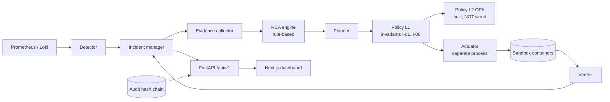

# Cloud Doctor: current-state analysis

Date: 2026-11-01. Branch: `integration` (HEAD 5f6a1bc at the time of writing).
Method: read-only inspection of the repository (source, contracts, tests, docs, infra, frontend). Nothing was built or run for this document.

**Not verified.** The pass counts below come from the repo's own docs, not from a run for this analysis. `docs/14-research-summary/integration-plan.md` reports 585 passed and 19 skipped (31 Oct), and 272 passed and 19 skipped for backend plus harness after the 1 Nov laptop fixes. The frontend has never run against the real backend.

The next milestone is MVP acceptance on 5 Nov 2026 (`docs/14-research-summary/mvp-plan-5-nov.md`).

## 1. Existing architecture

Principle already in the repo: deterministic code does detection, policy, execution and verification; AI may only explain and recommend, and the system must work without it (ADR-003, "C0").

| Component | Location | Notes |
|---|---|---|
| Backend | `backend/` (FastAPI) | `main.py` entry; `services.py` `Orchestrator` polls every 5 s: detect, ingest, sweep, diagnose, remediate |
| Repositories | `backend/repositories/` | `MemoryRepository` by default; `SqlRepository` (SQLAlchemy Core) when `CD_DATABASE_URL` is set |
| Policy L1 | `invariants/` | Rules I-01..I-08, fail closed |
| Policy L2 | `policy/` | OPA Rego, can only tighten; not wired into the backend |
| Actuator | `actuator/` | Separate process on a unix socket; verifies HMAC-signed plan, expiry, nonce, idempotency; re-runs L1; checks container labels; only executes `docker restart cd-<name>` |
| Contracts | `contracts/` | Frozen v1 schemas, `openapi.yaml`, `db/schema.sql` (14 tables), `cause_ids.md`, `audit_events.md` |
| Harness | `harness/`, `experiments/scenarios/` | External fault injection with ground truth that never reaches the API |
| Infra | `infra/` | Docker Compose sandbox; frozen service catalog `infra/catalog/services.yaml` |
| Frontend | `frontend/` | Next.js 16, React 19, TypeScript, static export behind nginx |
| AI | `ai/` | README only |

Work is organised as parallel streams (`stream/backend`, `stream/frontend`, `stream/harness`, `stream/infra`, `stream/policy`; rules in `docs/dev/streams.md`). `integration` combines them by copy, so the stream branches are not git ancestors of it.

## 2. Existing features

- **Detection.** Nine rules in `backend/config/detector.yaml`: service_down, telemetry_gap, error_ratio, latency_p95, queue_growth, queue_absent, dependency_down, restart, memory_growth. Signals are tri-state (breach, clear, hold), with hysteresis, a low-traffic guard and an expected-state registry. Missing data never counts as healthy.
- **Correlation.** An alert joins an open incident when its service is in or adjacent to the incident's services (undirected dependency graph) and fires within 120 s. Unrelated concurrent faults open separate incidents. A restart alone does not open an incident.
- **Incident states.** detected, investigating, diagnosed, remediating, verifying, recovered, escalated, closed.
- **Evidence.** `EV-###` ids, sha256 payload hash, log evidence flagged `untrusted`, summaries built from counts and never from log text.
- **RCA.** See section 6.
- **Remediation.** Typed plans with a `plan_hash`; medium risk needs an approval bound to that hash; high risk is never executable; attempt budget, cooldown and circuit breaker.
- **Verification.** See section 6.
- **Audit.** Append-only sha256 hash chain; `chain_valid` returned by `GET /audit`.
- **Prompt-injection posture.** Log text is data only. It does not reach the executor, the OPA input or RCA decisions, and reports escape it. There is no LLM path yet, so there is no sanitiser or injection corpus.

## 3. Existing UI

Real app (`frontend/src/app/`): Overview, Topology, Incident list, Incident detail (tabs Timeline, Evidence, Diagnosis, Remediation, Verification, Report), Service view (metrics, logs), Audit, Login. Ids travel in the query string because of static export.

- Data comes from `/api/v1` (nginx proxy). `npm run dev` uses a mock server (`frontend/mock/`) with SSE replay.
- Styling is a single 83-line `src/app/globals.css`. No design system.
- 132 Vitest tests are reported in `docs/dev/frontend/STATUS.md`, including hostile-input rendering and a forbidden-API scan.
- There is no sandbox badge in the Next.js app.
- `docs/dev/frontend/ux-prototype.html` (standalone, 673 lines) is much richer: incident banner, 11-stage pipeline, Observability and Access views, role-based access, CSS tokens. It is the intended template and is not wired into the app.

| Target screen | State |
|---|---|
| Overview, Topology, Incident list, Summary, Timeline, Evidence | exists |
| Infrastructure RCA | partial (Diagnosis tab, no infra/code split) |
| Remediation, Verification, Report, Audit | exists |
| Code RCA | missing |
| Access / Policy | missing (prototype only) |
| Code Intelligence | missing |
| Simulation Control, sandbox badge | missing |

## 4. Existing APIs

All under `/api/v1` (`backend/api/app.py:212-432`, contract `contracts/openapi.yaml`). Cookie session from a shared token; mutating routes require `Idempotency-Key`.

`POST auth/login`, `POST auth/logout`, `GET services`, `GET services/{s}/health|metrics|logs`, `GET topology`, `GET incidents`, `GET incidents/{id}`, `GET incidents/{id}/timeline|evidence|diagnosis|remediation|verification|report`, `POST incidents/{id}/diagnose`, `POST incidents/{id}/remediation/plans/{plan}/approve|reject`, `GET audit`, `GET stream` (SSE, replay from a 1000-entry buffer), `GET status` (unauthenticated).

Against the endpoint list in the product brief:

| Brief | State |
|---|---|
| incidents, incident, timeline, evidence, diagnosis, remediation, verification, report | exists |
| `GET /incidents/{id}/topology` | missing (only global `/topology`) |
| `POST /investigate`, `/remediation/execute`, `/verify` | missing; execution is system-initiated by design, so a manual execute endpoint needs a policy decision before it is added |
| `GET/POST /code-analysis` | missing |
| scenario inject / reset | missing |

`docs/audit_events.md` and the code disagree slightly on the approve route path (`/plans/` segment).

## 5. Existing data model

`contracts/db/schema.sql` defines 14 tables: services, service_dependencies, incidents, alerts, evidence, timeline_events, hypotheses, plans, policy_decisions, approvals, executions, verifications, experiment_runs, audit_log. Domain models are frozen pydantic classes in `backend/domain/models.py` mirroring `contracts/schemas/*.json`.

Mapping to the entity list in the brief:

| Brief entity | Existing |
|---|---|
| Service, Dependency | yes |
| Incident, IncidentEvent | yes (`TimelineEvent`, `TL-####`) |
| Evidence | yes |
| Hypothesis, RCAFinding | `Hypothesis` plays both roles; see gaps below |
| RemediationPlan / RemediationAction | `Plan` (`PL-####`) |
| Policy | decisions exist (`Decision`, `DEC-####`, L1 and L2 results); no policy entity |
| Approval, Execution, Verification, AuditEvent | yes |
| CodeReference, Repository, Commit | missing |

Gaps in the RCA record versus the brief:

- The field is `confidence`; the brief wants `ranking` plus the statement that it is an evidence-weighted prioritisation score and not a probability.
- No `category` (the 11 values in the brief).
- Statuses are candidate, supported, refuted, confirmed; the brief wants candidate, supported, strong_candidate, confirmed, rejected, unknown.
- No `code_references`, no recommended-next-investigation field, no standalone RCA id.

Persistence debt: no Alembic migrations (raw `schema.sql` is executed). Sessions, idempotency records, the SSE buffer, plan state and circuit-breaker state are held in memory.

## 6. Existing RCA and verification

**RCA** (`backend/rca/engine.py`, `backend/rca/facts.py`), deterministic, no LLM, no randomness.

- Candidate causes are `<service>_<kind>`: unavailable, bad_deployment, memory_exhaustion, cpu_saturation, connection_exhaustion, network_latency (database only), disk_full, local_fault (capped at 0.35), telemetry_collection_failed, undetermined_cause (`contracts/cause_ids.md`).
- Every claim cites at least one evidence id; `remediation/engine.py:72 diagnosis_is_valid` checks the citations exist.
- Score: coverage of satisfied signal weight, times a factor for independent signal types (0 types gives 0, 1 gives 0.6, 2 gives 0.85, 3 or more gives 1.0), times one minus the contradiction share. Temporal-only support is capped at 0.30; overall cap 0.95. `confidence_basis` records the factors.
- Status: refuted if contradiction is 0.5 or more; supported if confidence is 0.6 or more and contradiction is below 0.25; otherwise candidate. RCA never sets `confirmed`.
- Uncertainty is first-class: `contradicting`, `alternatives` and `unknowns` per hypothesis. Missing telemetry is an unknown, not an absence of fault. A restart is never a cause.
- Thresholds added for connection, database-call and disk signals are marked provisional (`DB_CALL_THR` 0.25, `DB_PROBE_THR` 0.05, `FS_FULL` 0.95).

**Verification** (`backend/verifier.py`): 10 s settle, then a 45 s stability window sampled every 5 s against a baseline from before the first symptom. Seven checks: readiness, dependencies, error SLI, latency SLI, synthetic transaction (independent probes), no regression elsewhere, telemetry freshness. A check that cannot be established is `null` and forces `unverifiable`. Verdicts: recovered, partial, failed, regression, relapse, unverifiable.

## 7. Existing self-healing

- Action ids: restart_service, rollback_service, scale_service, clear_cache, isolate_dependency, escalate. Per-service `allowed_actions` live in `infra/catalog/services.yaml` (api: restart, rollback, escalate; worker: restart, escalate; redis: restart, clear_cache, escalate; database and loadgen: escalate only).
- `backend/remediation/catalogue.py` maps cause to action: unavailable gives restart; bad_deployment gives rollback only when a previous version is known; memory_exhaustion gives restart, or escalate after two restarts; everything else escalates.
- **Only `restart_service` actually executes.** The other actions are catalogued and policy-checked but have no executor.
- Signing: HMAC-SHA256 envelope with key id, expiry, nonce and optional approval, key from a mode-0600 file; missing or loose key means fail closed (`backend/remediation/signing.py`).
- Sandbox: required label `cloud-doctor.sandbox=true` (rule I-02), internal network, loopback-only ports, restart policy `no`. Plain Docker stands in for the micro-VM design; spikes S1 to S7 never ran.

## 8. Code-level RCA

**Absent.** There is no repository, commit, diff, blame or stack-trace analysis and no mapping from a symptom to source.

- `bad_deployment` only detects a `build_info` version change; `_NoFeed` in `backend/services.py` means no deploy or change feed is wired in.
- RCA records "which code change is defective is not observable" as a standing unknown.
- `backend/normalize/logs.py` recognises `stack`/`stacktrace` keys but does not parse them.
- The demo application contains no defect to find (see 9.1).

## 9. Existing limitations and technical debt

1. **The demo app has no leaky code.** `infra/sim/app/` (about 400 lines: `api.py`, `worker.py`, `loadgen.py`, `probes.py`, `common.py`) opens a fresh `psycopg.connect` per request, with no pool. EXP-05 exhausts connections with an external `connection_hog`, not an application bug. There is no source repository or git history for Code RCA to cite. This is the main blocker for the primary scenario.
2. **No scenario trigger.** Faults are injected by the harness CLI or `docker`; `make reset` is the only reset. `backend/demo_replay.py` replays synthetic fixtures and is not a live run.
3. **Scenario coverage:**

| Brief scenario | Closest existing | State |
|---|---|---|
| Redis outage | EXP-01 | designed |
| Worker crash | EXP-02 | designed |
| DB connection exhaustion | EXP-05 | injection not implemented in the harness; no code defect |
| Ambiguous failure | EXP-09 (CPU hog plus benign deploy decoy) | rough match only |

   EXP-11 (disk full) and EXP-12 (telemetry outage) are drafts.
4. **Open findings** (`docs/14-research-summary/integration-plan.md`):
   - One database fault opens two incidents (api and worker) because `app-db` is not in the affected set.
   - Sandbox apps log only `OperationalError`, so the "too many clients" log signature cannot fire.
   - Connection and network-latency thresholds rest on one real run; the network-latency and disk rules never ran on real telemetry.
   - The detector reads `queue_depth`, not `cd_queue_length` (backend-1 half done).
   - Deferred contract change requests: policy-2, frontend-3, harness-4.
5. **Policy layer 2 is not wired.** `/status` hard-codes it as disabled, and the 0.8 confidence threshold in `policy.rego` is therefore never applied. The backend can also fall back to a local stub of the invariants (`CD_INVARIANTS=auto`) if the real package is not importable.
6. **Verification blocks the orchestrator thread** (`clock.sleep` inside the engine lock) for about 55 s per verification, which stalls detection.
7. **Single shared auth token.** No per-user roles and no named approver, though the audit contract mentions `operator:<name>` and the prototype assumes roles.
8. **The backend, actuator and frontend have never run together.** The compose file contains only the sandbox, not the Cloud Doctor services.
9. **Two audit chains** (backend and actuator) that are not joined.
10. **The normalisation layer is not adopted.** `backend/normalize/` is tested, but the evidence collector and RCA still match raw text.
11. **No Kubernetes**, no Alertmanager, no Grafana. `ai/` is empty.
12. **Documentation drift.** The root `README.md` says "Prototype: None, no code exists". ADRs 001 to 006 are still Proposed; only ADR-007 is Accepted. Docs live in numbered research folders (`09-security`, `13-decisions`, ...), not the layout in the brief.
13. **Test gaps.** Alertmanager duplicate-delivery is untested (only `test_timeline_dedup`); PostgreSQL 18 backend tests (4) are skipped; frontend e2e is absent; the CPU-saturation detection test is not obvious.

## 10. Test coverage against the brief

| Area | Coverage |
|---|---|
| Detection (service, dependency, resource exhaustion) | covered; resource exhaustion partial |
| Correlation: duplicate alerts | weak |
| Correlation: dependent failures, unrelated simultaneous failures | covered |
| RCA: correct cause, competing hypotheses, insufficient evidence | covered |
| Code RCA (known faulty path, unrelated code, changed code, ambiguous stack trace) | absent |
| Remediation: allowed, denied, approval-required, failed | covered |
| Verification: success, partial, false recovery, regression | covered |
| Untrusted log text | covered (`test_poisoned_log_text_never_influences_diagnosis_or_plan`, `frontend/tests/hostile.test.tsx`) |

Roughly: backend 150 tests, harness 90, invariants 71, actuator 62, policy 30, plus contract and integration scripts and 9 frontend test files. There is no root pytest configuration; areas are run as `pytest tests/<area>`, and `make contracts` runs the schema validator.

## 11. Missing functionality (summary)

Code RCA pipeline and data model (CodeReference, Repository, Commit); leaky demo application with source and git history; RCA `category`, `ranking`, new statuses and next-investigation field; scenario registry and inject/reset API; ambiguous-failure scenario with an explicit "root cause unknown" outcome; per-incident topology endpoint; Code RCA, Code Intelligence, Access/Policy and Simulation Control screens; sandbox badge; RCA chain and graph visualisation; clickable evidence chips; actuator support for actions beyond restart; Layer 2 wiring; role-based approvals; the target documentation set.

## 12. Reusable components

Do not rebuild: detector, incident manager, evidence collector, RCA scoring and `confidence_basis`, planner, signing, actuator, Layer 1 invariants, verifier, audit chain, harness fault library, SSE stream, report builder, frozen contracts with generated TypeScript types, mock server, forbidden-API scan, and the UX prototype as the visual template.

## 13. Recommended evolution path

Ordered for the 5 Nov milestone (P0 first). Contract changes go through `docs/dev/contract-change-requests/`.

1. **Leaky demo app (P0).** Add a pooled DB layer to `infra/sim/app/` with a deliberate exception-path connection leak behind a switch, in a small git repository so commit and blame data exist. Emit a log signature the detector can see.
2. **RCA data model (P0).** Add `category`, `ranking` semantics, the new statuses, `code_references` and next-investigation to the hypothesis contract. Add CodeReference, Repository and Commit.
3. **Code RCA (P0).** Deterministic pipeline: service, error pattern or stack trace, candidate files and functions (Python AST), dependency calls, git changes, candidate fault location, evidence correlation. Add `/incidents/{id}/code-analysis`. An LLM may only phrase results and must pass schema and evidence-grounding checks.
4. **Correlation fix (P0).** Include the shared dependency in the affected set so one database fault yields one incident.
5. **Scenarios and Simulation Control (P0).** Registry for the four scenarios and a sandbox-only inject/reset API; expected diagnosis is stored with each scenario and kept out of engine inputs, as the harness already does.
6. **Remediation and verification (P0/P1).** Wire Layer 2, implement the actions the demo needs, move verification off the orchestrator thread.
7. **UI (P0).** Port the UX prototype, add the sandbox badge, Code RCA tab, evidence chips, RCA chain and graph, Simulation Control. Access/Policy and Code Intelligence are P1.
8. **Tests (P0/P1).** Code RCA cases, duplicate alerts, database-down correlation.
9. **Integration run.** Put backend, actuator and frontend in the compose stack and run the 15-step demo end to end before claiming it works.
10. **Docs (P1).** Add the architecture, product and security documents from the brief, refresh the README, and decide the status of ADR-001 to ADR-006.

## 14. Decisions needed from the owner

- Whether to branch from `integration` for this work, and when to merge `integration` to `main`.
- Whether Code RCA is deterministic-first with optional LLM phrasing (recommended).
- Whether new RCA fields go through the contract-change process (recommended).
- Whether Python-only Code RCA is acceptable, since the demo app is Python.
- Whether a manual remediation-execute endpoint is wanted at all, given that execution is system-initiated today.
